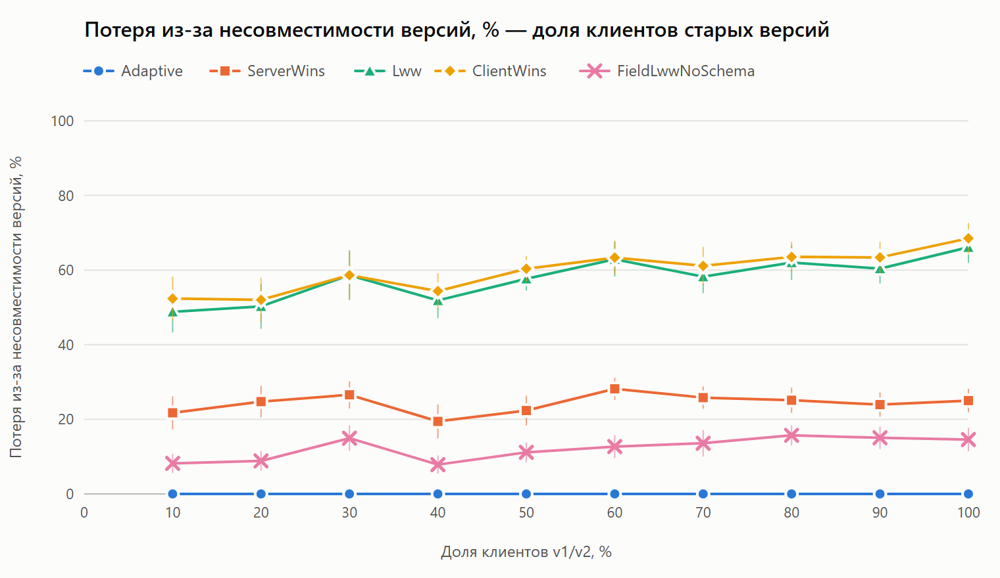
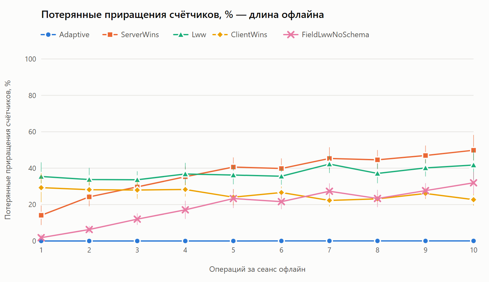

::: {custom-style="Udc"}
УДК 004.65:004.75
:::

::: {custom-style="ArticleTitle"}
Адаптивный метод синхронизации локальной и серверной баз данных мобильной информационной системы с учётом версионной совместимости схем данных
:::

::: {custom-style="Authors"}
Безнос О. С., Мухаметшин Л. Э., Задорожний Л. Ю.
:::

::: {custom-style="Affiliation"}
ФГБОУ ВО «Кубанский государственный технологический университет», Краснодар, Россия
:::

::: {custom-style="Email"}
e-mail: leonmukhametshin2004@gmail.com; leonidzador2106@mail.ru
:::

::: {custom-style="AbstractText"}
**Аннотация.** Рассматривается задача синхронизации локальной (SQLite) и серверной (PostgreSQL) баз данных мобильной информационной системы, работающей в автономном режиме, при одновременной эксплуатации клиентов разных версий. Клиент устаревшей версии не знает атрибутов, добавленных в схему данных позднее, и при согласовании состояний после восстановления соединения базовые стратегии разрешения конфликтов — Last Write Wins, Server Wins, Client Wins — либо затирают такие атрибуты значениями по умолчанию, либо отклоняют корректные изменения клиента. Цель работы — разработать метод синхронизации, который выбирает правило применения изменения в зависимости от совместимости версии схемы клиента с серверной схемой, наличия конфликтующих изменений и категории данных. Предложены классификация ситуаций синхронизации S1–S5 с критериями правильного результата для каждой из них и адаптивный метод, принимающий решение на уровне отдельного поля по версиям полей и множеству полей, известных клиенту. Сформулированы и обоснованы свойства метода: поля вне схемы клиента не изменяются, приращения счётчиков не теряются, удаление записи с данными новых версий заменяется пометкой с сохранением данных. Экспериментальное исследование выполнено на прототипе с независимой эталонной моделью и генератором сценариев: 41 конфигурация по 30 запусков, сравнение с четырьмя базовыми стратегиями и тремя упрощёнными вариантами метода, сквозной замер на PostgreSQL, а также демонстрация ситуаций S3–S5 в мобильном приложении с переключением стратегий. Потеря данных из-за несовместимости версий у предложенного метода равна нулю против 22–61 % у стратегий уровня записи, все конфликты разрешаются автоматически и в соответствии с критериями, а время принятия решения составляет менее 0,2 % времени обработки запроса синхронизации.
:::

::: {custom-style="AbstractText"}
**Ключевые слова:** синхронизация баз данных; автономный режим; мобильная информационная система; эволюция схемы данных; версионная совместимость; разрешение конфликтов; оптимистическая репликация; SQLite; PostgreSQL.
:::

::: {custom-style="ArticleTitle"}
An Adaptive Method for Synchronizing Local and Server Databases of a Mobile Information System Taking into Account Schema Version Compatibility
:::

::: {custom-style="Authors"}
O. S. Beznos, L. E. Mukhametshin, L. Y. Zadorozhny
:::

::: {custom-style="Affiliation"}
Kuban State Technological University, Krasnodar, Russia
:::

::: {custom-style="Email"}
e-mail: leonmukhametshin2004@gmail.com; leonidzador2106@mail.ru
:::

::: {custom-style="AbstractText"}
**Abstract.** The paper addresses synchronization of a local (SQLite) and a server (PostgreSQL) database in a mobile information system that operates offline while clients of different application versions are in use at the same time. An outdated client is unaware of attributes added to the data schema later, and when states are reconciled after reconnection, baseline conflict resolution strategies — Last Write Wins, Server Wins, Client Wins — either overwrite such attributes with default values or reject valid client changes. The aim of the work is to develop a synchronization method that chooses how to apply a change depending on the compatibility of the client schema version with the server schema, on the presence of conflicting changes, and on the data category. A classification of synchronization situations S1–S5 with correctness criteria for each of them is proposed, together with an adaptive method that makes field-level decisions from field versions and the set of fields known to the client. The properties of the method are stated and justified: fields outside the client schema are never modified, counter increments are never lost, and deletion of a record holding newer-version data is replaced with a tombstone that preserves the data. The experimental study uses a prototype with an independent reference model and a scenario generator: 41 configurations with 30 runs each, comparison with four baseline strategies and three reduced variants of the method, an end-to-end measurement on PostgreSQL, and a demonstration of situations S3–S5 in a mobile application with run-time strategy switching. The proposed method shows zero data loss caused by version incompatibility against 22–61 % for record-level strategies, resolves all conflicts automatically and in accordance with the criteria, and spends less than 0.2 % of the synchronization request processing time on decisions.
:::

::: {custom-style="AbstractText"}
**Keywords:** database synchronization; offline mode; mobile information system; schema evolution; version compatibility; conflict resolution; optimistic replication; SQLite; PostgreSQL.
:::

# ВВЕДЕНИЕ / INTRODUCTION

Мобильные информационные системы всё чаще работают по схеме, в которой клиент хранит часть данных в локальной встраиваемой СУБД и продолжает работу без соединения с сервером. Изменения, сделанные в автономном режиме, накапливаются в журнале и передаются на сервер после восстановления соединения; за это время серверная копия данных также может измениться под действием других клиентов и серверной логики. Задача согласования состояний относится к классу задач оптимистической репликации, в которой расхождение реплик допускается, а конфликты обнаруживаются и разрешаются при синхронизации [15; 18; 20].

Практически используемые стратегии разрешения конфликтов просты: побеждает последняя запись по времени (Last Write Wins, LWW) [5], всегда побеждает сервер (Server Wins) или всегда побеждает клиент (Client Wins). Эти стратегии разрабатывались в предположении, что клиент и сервер используют одну и ту же структуру данных. В мобильной системе это предположение нарушается: пользователи обновляют приложение не сразу, поэтому одновременно работают клиенты нескольких версий, а схема данных на сервере всегда соответствует последней версии. Клиент старой версии не знает атрибутов, появившихся позже, и не может передать их значения. Если стратегия перезаписывает запись целиком, такие атрибуты получают значения по умолчанию, то есть теряются данные, о существовании которых клиент даже не знал. Если стратегия отклоняет изменение клиента при любом изменении записи на сервере, теряются корректные изменения пользователя.

Цель работы — разработать метод синхронизации локальной и серверной баз данных мобильной информационной системы с поддержкой автономного режима, который выбирает правило применения изменений в зависимости от совместимости версии схемы клиента с серверной схемой, наличия конфликтующих изменений и категории данных, и экспериментально сравнить его с базовыми стратегиями. Для достижения цели решаются задачи: формализовать модель данных с несколькими версиями схемы; выделить ситуации синхронизации и определить для каждой из них правильный результат; построить метод и обосновать его свойства; реализовать прототип SQLite + PostgreSQL и провести экспериментальное исследование по измеримым показателям — потере данных из-за несовместимости версий, доле корректно применённых изменений клиентов, доле сохранённых серверных данных, доле автоматически и верно разрешённых конфликтов, времени синхронизации и объёму передаваемых данных.

Научная новизна работы состоит в том, что выбор правила разрешения конфликта при синхронизации связывается с версионной совместимостью схем данных клиента и сервера: решение принимается для каждого поля с учётом того, входит ли оно в схему клиента, менялось ли на сервере после последней синхронизации клиента и к какой категории данных относится, а удаление записи клиентом старой версии превращается в пометку с сохранением данных, неизвестных этому клиенту.

# 1. ОБЗОР ЛИТЕРАТУРЫ / LITERATURE REVIEW

## 1.1. Разрешение конфликтов при оптимистической репликации

Работа в отключённом режиме и последующее согласование реплик исследуются с конца 1970-х годов. Правило Томаса, по которому из двух конкурирующих изменений сохраняется более позднее, предложено при сопровождении дублированных баз данных [5] и до сих пор лежит в основе стратегии LWW. Логические часы Лэмпорта [10] позволяют упорядочивать события без синхронизированного физического времени, а векторы версий [11] — обнаруживать параллельные изменения. В файловой системе Coda отключённая работа клиента и последующая реинтеграция изменений были реализованы на практике [6], а в системе Bayou [18] разрешение конфликтов передано приложению: каждая запись сопровождается проверкой зависимостей и процедурой слияния. Обзор методов оптимистической репликации [15] систематизирует эти подходы и показывает, что выбор способа разрешения конфликтов определяется семантикой данных, а не механизмом репликации.

Для серверных систем с высокой доступностью согласованность «в конечном счёте» [19] и ограничения, следующие из теоремы CAP [4], обосновывают отказ от немедленной согласованности в пользу последующего согласования. В хранилище Dynamo [3] конфликтующие версии сохраняются и передаются приложению для слияния. Механизм многоверсионного управления параллельным доступом [1] показывает, как версии данных используются для обнаружения конфликтов внутри одной СУБД; в настоящей работе тот же принцип перенесён на уровень отдельных полей записи.

## 1.2. Бесконфликтные типы данных и локально-ориентированные приложения

Альтернативу явному разрешению конфликтов предлагают бесконфликтные реплицируемые типы данных (CRDT) [16]: операции над ними коммутативны, и реплики сходятся без координации. Для документов JSON разработан соответствующий тип [8], а концепция local-first приложений [9] предлагает строить пользовательские приложения так, чтобы основная копия данных находилась у пользователя. CRDT хорошо подходят для счётчиков, множеств и текста, однако требуют, чтобы все участники понимали один и тот же тип данных. Клиент старой версии, которому атрибут неизвестен, не может участвовать в его слиянии, поэтому сама по себе модель CRDT не решает проблему эволюции схемы.

## 1.3. Эволюция схемы и совместимость версий клиентов

Проблемы версионирования схем баз данных систематизированы в обзоре [14], а средства сопровождения эволюции схемы с сохранением работоспособности запросов предложены в системе PRISM [2]. Эти работы рассматривают изменение схемы внутри одной базы данных, а не согласование реплик с разными версиями схемы. Для форматов сериализации совместимость «вперёд» и «назад» обеспечивается правилом сохранения неизвестных полей [7; 13]: получатель, не знающий поля, не удаляет его при повторной записи. В синхронизации реплик с журналом изменений это правило выполняется не автоматически: стратегии уровня записи перезаписывают запись целиком, а стратегии, не учитывающие версию схемы, не различают удаление записи, известной клиенту полностью, и удаление записи, часть данных которой клиент не видит.

Таким образом, существующие подходы либо решают задачу разрешения конфликтов без учёта различий схем, либо задачу эволюции схемы без учёта автономной работы клиентов. Настоящая работа устраняет этот разрыв для класса систем с журналом изменений клиента и серверной копией данных.

# 2. МАТЕРИАЛЫ И МЕТОДЫ / MATERIALS AND METHODS

## 2.1. Модель данных

Схема данных существует в версиях $v = 1, \dots, V$, сервер всегда использует последнюю версию $V$, клиент — версию $v \le V$. Для каждой таблицы $T$ и поля $f$ задана версия появления $\mathrm{intro}(T, f)$. Множество полей, известных клиенту версии $v$:

$$K(v) = \{ (T, f) : \mathrm{intro}(T, f) \le v \}, \qquad K(1) \subset K(2) \subset \dots \subset K(V).$$

Каждому полю приписана категория $c(f)$, задающая приоритет при конфликте: $\mathit{user\_owned}$ и $\mathit{user\_preference}$ — данные, которыми распоряжается пользователь (имя, настройки); $\mathit{server\_authoritative}$ — данные, за которые отвечает сервер (уровень, регион); $\mathit{counter}$ — накапливаемые величины (баланс, количество), изменения которых складываются; $\mathit{scalar}$ — прочие значения. Новые поля в существующих таблицах не могут быть обязательными и имеют значение по умолчанию $d_f$, поэтому клиент старой версии может создавать записи.

Серверная запись $r$ хранит значения полей $x_f$, номер версии строки $\rho_r$ из глобальной возрастающей последовательности, признак удаления и версии полей $\mathrm{fv}_r(f) = (\rho_f, \tau_f)$, где $\rho_f$ — номер версии, при которой поле записано последний раз, а $\tau_f$ — логическое время этой записи [10]. Клиент хранит локальную копию в SQLite и журнал операций. Операция журнала

$$o = (r, \kappa, b, t, \Delta), \qquad \Delta = \{ (f, x^{\mathrm{old}}_f, x^{\mathrm{new}}_f) \},$$

содержит запись $r$, тип $\kappa \in \{\mathrm{insert}, \mathrm{update}, \mathrm{delete}\}$, базовую версию $b$ — номер версии строки, которую клиент видел при последней синхронизации, логическое время $t$ и изменённые поля. Клиент передаёт только поля из $K(v)$; поле вне $K(v)$ в операции считается ошибкой протокола и отклоняется сервером.

## 2.2. Ситуации синхронизации и критерии правильного результата

Изменение поля $f$ операцией $o$ находится в конфликте, если поле записывалось на сервере после состояния, которое видел клиент:

$$\mathrm{conf}(o, f) \iff \rho_f > b.$$

На основе этого предиката и версии клиента выделены пять ситуаций (таблица 1). Критерии правильного результата сформулированы до построения метода и реализованы в независимой эталонной модели (оракуле), которая не использует код метода.

| Ситуация | Условие | Правильный результат |
|:--|:----|:----|
| S1 | $v = V$, конфликта нет | изменения клиента применены |
| S2 | $v < V$, конфликта нет, поля вне $K(v)$ после $b$ не менялись | изменения клиента применены, поля вне $K(v)$ не изменены |
| S3 | $v < V$, конфликта нет, поля вне $K(v)$ менялись после $b$ | серверные значения полей вне $K(v)$ сохранены, изменения клиента в $K(v)$ применены |
| S4 | $\mathrm{conf}(o, f)$ для поля $f \in K(v)$ | результат определяется категорией поля (формула 1) |
| S5 | удаление клиентом $v < V$ записи с данными вне $K(v)$ или со связанными записями в таблицах новее $v$ | запись помечается удалённой (tombstone), её данные и связанные записи сохраняются |

::: {custom-style="TableNote"}
Таблица 1. Ситуации синхронизации и критерии правильного результата / Table 1. Synchronization situations and correctness criteria
:::

Для конфликта (S4) значение поля после синхронизации определяется категорией:

$$x_f = \begin{cases} x^{\mathrm{cur}}_f + (x^{\mathrm{new}}_f - x^{\mathrm{old}}_f), & c(f) = \mathit{counter}, \\ x^{\mathrm{new}}_f, & c(f) \in \{\mathit{user\_owned}, \mathit{user\_preference}\}, \\ x^{\mathrm{cur}}_f, & c(f) = \mathit{server\_authoritative}, \\ x^{\mathrm{new}}_f \text{ при } t > \tau_f, \text{ иначе } x^{\mathrm{cur}}_f, & c(f) = \mathit{scalar}, \end{cases} \qquad (1)$$

где $x^{\mathrm{cur}}_f$ — текущее серверное значение. При равенстве логического времени у поля категории $\mathit{scalar}$ побеждает сервер. Конфликт создают только изменения, которые были фактически применены: попытка изменения, проигравшая конфликт, не делает конфликтными последующие изменения других клиентов, видевших актуальное значение.

Два вопроса, от которых зависит алгоритм и определение потери данных, решены так. Поля, неизвестные клиенту старой версии, хранятся только на сервере до обновления приложения: клиенту они не передаются, и его локальная база остаётся в своей версии схемы. Удаление записи клиентом старой версии выполняется как пометка с сохранением данных, если у записи есть значение вне $K(v)$, отличное от значения по умолчанию, или живая связанная запись в таблице, появившейся после версии $v$:

$$\mathrm{keep}(r, v) \iff \exists\, g \notin K(v):\ x_g \ne d_g \ \lor\ \exists\, T' \in D_r:\ \mathrm{intro}(T') > v, \qquad (2)$$

где $D_r$ — таблицы, в которых есть неудалённые записи, ссылающиеся на $r$.

## 2.3. Адаптивный метод синхронизации

Метод выполняется на сервере для каждой операции пакета, полученного от клиента, внутри транзакции с блокировкой изменяемой записи. Вход — версия схемы клиента $v$, операция $o$ и снимок серверной записи $r$ со значениями, версиями полей и множеством $D_r$; выход — набор записываемых значений, исход по каждому полю с отнесением к ситуации S1–S5 и исход операции.

::: {custom-style="Algorithm"}
**Алгоритм 1.** Адаптивное применение операции $o = (r, \kappa, b, t, \Delta)$ клиента версии $v$\
1. Если $r$ отсутствует или удалена: для вставки применить все поля $\Delta$ (S1 при $v = V$, иначе S2), иначе отклонить операцию.\
2. Если $\kappa = \mathrm{delete}$: при $v < V$ и $\mathrm{keep}(r, v)$ — пометить запись удалённой без изменения данных (S5, исход Tombstoned); иначе обычное удаление (S1 или S2).\
3. Определить ситуацию без конфликта: S1 при $v = V$; S3, если $\exists\, g \notin K(v): \rho_g > b$; иначе S2.\
4. Для каждого $(f, x^{\mathrm{old}}_f, x^{\mathrm{new}}_f) \in \Delta$:\
   4.1. если $f \notin K(v)$ — отклонить поле (ошибка протокола);\
   4.2. если $\neg\,\mathrm{conf}(o, f)$ — записать $x^{\mathrm{new}}_f$ с ситуацией шага 3;\
   4.3. иначе вычислить $x_f$ по формуле (1) и записать его, если правило не оставило серверное значение (S4).\
5. Поля вне $K(v)$, отсутствующие в $\Delta$, не изменять.\
6. Исход операции: Applied, если все поля применены без правил категорий; Merged, если хотя бы одно поле решено правилом или отклонено, но запись изменена; Rejected, если ничего не записано.\
7. Для записанных полей установить $\mathrm{fv}_r(f) = (\rho', t)$, где $\rho'$ — новая версия строки; записать исход в журнал операций сервера и вернуть клиенту исход операции, ситуацию S1–S5 и решение по каждому полю.
:::

Если в одном пакете клиент изменяет одну запись несколько раз, его собственные предыдущие записи не должны считаться конфликтом. При этом нельзя просто заменить базовую версию $b$ на версию, созданную предыдущей операцией пакета: тогда изменение другого клиента, которого этот клиент не видел, перестаёт обнаруживаться и затирается. Поэтому перед каждой операцией версии полей, записанных этим же пакетом, заменяются на $b$ во снимке записи — кроме полей, которые к моменту первой собственной записи уже были изменены другим автором после $b$; такие поля остаются конфликтными, и, например, повторное изменение счётчика снова складывается с текущим значением.

## 2.4. Свойства метода

**Утверждение 1** (сохранение данных вне схемы клиента). Для любой операции клиента версии $v$ метод записывает только поля из $K(v)$. *Обоснование.* На шаге 4 записываются только поля из $\Delta$, а поля вне $K(v)$ отклоняются на шаге 4.1; шаги 2 и 5 не изменяют значения полей. Следовательно, значения полей вне $K(v)$ после применения операции совпадают с серверными, что составляет критерий ситуаций S2 и S3.

**Утверждение 2** (сохранение приращений счётчиков). Пусть все изменения поля категории $\mathit{counter}$ записи, не удалённой к моменту их доставки, заданы как приращения относительно значения, которое видел автор. Тогда после обработки всех операций значение поля равно начальному значению плюс сумма всех приращений. *Обоснование.* Без конфликта сервер не менялся после $b$, поэтому $x^{\mathrm{cur}}_f = x^{\mathrm{old}}_f$ и запись $x^{\mathrm{new}}_f$ эквивалентна добавлению приращения; при конфликте приращение добавляется по формуле (1) явно; маскирование собственных записей пакета не снимает конфликт с оспоренных полей. Индукцией по порядку доставки операций получаем требуемое.

**Утверждение 3** (сохранение данных при удалении). Если клиент версии $v < V$ удаляет запись, для которой выполняется условие (2), то значения всех полей записи и все связанные записи сохраняются. *Обоснование.* На шаге 2 запись только помечается удалённой, значения не изменяются, каскадное удаление не выполняется.

Кроме того, метод детерминирован: решение зависит только от входных данных и логического времени, но не от физического времени и случайных величин. Вычислительная сложность обработки одной операции — $O(|\Delta| + |F_T| + |D_r|)$, где $|F_T|$ — число полей таблицы; дополнительная память на сервере ограничена версиями полей $\mathrm{fv}_r$, которые хранятся в столбце JSONB рядом с записью.

## 2.5. Прототип и методика эксперимента

Прототип реализован на C# (.NET 8). Клиент использует SQLite [17] и выполняется как в виде библиотеки, так и в мобильном приложении на Unity; сервер синхронизации реализован на ASP.NET Core с PostgreSQL 16 [12] и предоставляет единственный эндпоинт `/sync`, принимающий пакет операций и возвращающий исходы, состояние затронутых записей и изменения других клиентов. Схема данных имеет три версии: в версии 2 в профиль пользователя добавлены поля аватара и премиальной валюты, а в предмет — прочность; в версии 3 — поле региона и таблица модификаций предметов, ссылающаяся на предметы. Метод разрешения конфликтов вынесен в отдельный сервис с контрактом `POST /resolve`, не хранящий состояния: сервер синхронизации передаёт ему операцию и снимок записи и применяет полученное решение. Благодаря этому метод заменяется другим сервисом без изменения сервера и клиента; та же стратегия может выполняться и внутри сервера, что позволяет отделить время работы метода от сетевых затрат. На экспериментальном стенде стратегию можно переключать во время работы, не перезапуская сервер и не очищая данные, поэтому одни и те же действия пользователей воспроизводятся на разных стратегиях. Ответ сервера содержит для каждой операции ситуацию S1–S5 и решение по каждому полю (применено, слито с серверным значением, оставлено серверное значение, затёрто значением по умолчанию); мобильное приложение показывает их пользователю. Клиент версии 3 редактирует в приложении все поля профиля, включая поля новых версий, клиент версии 1 — только поля своей схемы; профиль можно удалить, что позволяет наблюдать ситуации S3–S5 непосредственно.

Для сравнения реализованы четыре базовые стратегии с тем же интерфейсом: Server Wins (операция отклоняется, если версия строки на сервере новее базовой); LWW и Client Wins на уровне записи (при победе клиента запись перезаписывается целиком, поля вне $K(v)$ получают значения по умолчанию); LWW на уровне полей без учёта версии схемы. Последняя служит контрольным вариантом: разница между ней и предложенным методом показывает вклад учёта версии схемы и категорий данных.

Эталонная модель (оракул) по начальному состоянию и журналу всех событий — изменений клиентов с версией схемы и моментами «изменение сделано», «состояние сервера видено», «изменение доставлено», а также изменений сервера — вычисляет правильное итоговое значение каждого поля и признак пометки удаления по критериям таблицы 1. Генератор сценариев по начальному числу (seed) детерминированно строит журналы: по умолчанию 4 профиля пользователей с предметами и модификациями, 6 клиентов, из которых половина старых версий (поровну версии 1 и 2), по 4 сеанса автономной работы из 3 операций; конфликтность — доля операций над «горячей» записью — 30 %; параллельно сервер изменяет поля новых версий и поля категории $\mathit{server\_authoritative}$. В пяти сериях по одному меняется параметр: доля старых клиентов (0–100 %), длина автономного сеанса (1–10 операций), конфликтность (0–60 %), число клиентов (2–20) и число записей (2–50 профилей); на каждую точку выполняется 30 запусков. Каждая стратегия проигрывается на одних и тех же журналах на модели сервера в памяти, поведение которой проверено сравнением с настоящим сервером (раздел 3.4).

Показатели качества делятся на две группы. Первая вычисляется сравнением с эталоном: потеря данных из-за несовместимости версий — доля полей вне $K(v)$ записей, которые изменяли или удаляли клиенты старых версий, с итоговым значением, отличным от эталона, с учётом удалений S5 без пометки; доля изменений клиентов (S1–S3), после которых значение поля совпало с эталоном; доля сохранённых серверных данных; доля конфликтов (S4), разрешённых верно. Поскольку эталон построен на тех же критериях, что и метод, вторая группа вычисляется непосредственно по решениям стратегии без эталона: число записей в поля вне $K(v)$; потерянные приращения счётчиков — сумма модулей разностей между ожидаемым значением (начальное значение плюс сумма всех приращений) и итоговым, отнесённая к сумме приращений; доля отклонённых операций клиентов; доля удалений записей с данными новых версий без пометки. Для каждого показателя рассчитываются среднее по запускам и половина 95 % доверительного интервала по распределению Стьюдента.

# 3. РЕЗУЛЬТАТЫ И ИХ ОБСУЖДЕНИЕ / RESULTS AND DISCUSSION

## 3.1. Сравнение с базовыми стратегиями

Результаты для базовой конфигурации приведены в таблице 2. Предложенный метод на всех запусках совпал с эталоном по каждому полю и признаку удаления; ни одной записи в поля вне схемы клиента, ни одного потерянного приращения и ни одного удаления данных новых версий без пометки не зафиксировано. Стратегии уровня записи LWW и Client Wins теряют 58–61 % данных, неизвестных старым клиентам, поскольку перезаписывают запись целиком: на каждые 100 операций приходится 45–63 записи значений по умолчанию в такие поля. Server Wins не затирает чужие поля, но отклоняет 44 % операций клиентов и правильно разрешает лишь треть конфликтов. LWW на уровне полей близок к предложенному методу по изменениям клиентов, но теряет 8,6 % данных, неизвестных старым клиентам, и 11 % приращений счётчиков, удаляет записи с данными новых версий без пометки и верно разрешает только две трети конфликтов.

| Показатель | Адаптивный метод | Server Wins | LWW | Client Wins | LWW по полям |
|:----|:-:|:-:|:-:|:-:|:-:|
| Потеря данных из-за несовместимости версий, % | 0,0 ± 0,0 | 22,3 ± 3,8 | 57,8 ± 5,0 | 61,2 ± 5,4 | 8,6 ± 1,9 |
| Корректно применённые изменения клиентов, % | 100,0 ± 0,0 | 77,3 ± 2,0 | 86,7 ± 1,3 | 100,0 ± 0,0 | 99,9 ± 0,1 |
| Сохранённые серверные данные, % | 100,0 ± 0,0 | 99,9 ± 0,3 | 100,0 ± 0,0 | 100,0 ± 0,0 | 100,0 ± 0,0 |
| Конфликты (S4), разрешённые верно, % | 100,0 ± 0,0 | 33,4 ± 4,2 | 58,5 ± 4,9 | 49,8 ± 4,3 | 66,5 ± 3,9 |
| Записи в поля вне $K(v)$ на 100 операций | 0,0 | 0,0 | 45,1 ± 3,8 | 62,7 ± 5,2 | 0,0 |
| Потерянные приращения счётчиков, % | 0,0 ± 0,0 | 27,3 ± 5,2 | 35,0 ± 6,1 | 29,5 ± 5,8 | 11,1 ± 3,0 |
| Отклонённые операции клиентов, % | 4,6 ± 1,0 | 44,3 ± 2,4 | 25,7 ± 2,3 | 0,0 ± 0,0 | 9,6 ± 1,5 |
| Удаления с данными новых версий без пометки, % | 0,0 | 100,0 | 100,0 | 100,0 | 100,0 |

::: {custom-style="TableNote"}
Таблица 2. Показатели стратегий в базовой конфигурации (среднее ± половина 95 % доверительного интервала, 30 запусков) / Table 2. Strategy metrics in the base configuration (mean ± half of the 95 % confidence interval, 30 runs)
:::

Отклонённые операции у предложенного метода (4,6 %) — это операции, все поля которых в конфликте решены в пользу сервера по категории $\mathit{server\_authoritative}$ или по более позднему серверному изменению категории $\mathit{scalar}$; такой исход соответствует критериям. Доля операций с исходом Merged составляет 29,6 %: это конфликты, разрешённые автоматически без участия пользователя.

## 3.2. Зависимость от параметров нагрузки

На рисунке 1 показана потеря данных из-за несовместимости версий в зависимости от доли клиентов старых версий. У предложенного метода она равна нулю во всём диапазоне, у стратегий уровня записи растёт с 49–52 % при 10 % старых клиентов до 66–69 % при 100 %, у Server Wins остаётся на уровне 19–28 %. Рисунок 2 показывает, что с ростом длины автономного сеанса потери приращений счётчиков у Server Wins увеличиваются с 14 до 50 %, у LWW по полям — с 1,8 до 32 %, тогда как у предложенного метода остаются нулевыми. В серии по числу клиентов доля отклонённых операций у Server Wins растёт с 22 до 68 %, а у предложенного метода — с 1,4 до 12 %, причём все такие отклонения соответствуют правилам категорий. Доля верно разрешённых конфликтов у предложенного метода равна 100 % при любой конфликтности от 0 до 60 %, у базовых стратегий — 29–66 %.

{width="16cm"}

{width="16cm"}

## 3.3. Вклад составных частей метода

Чтобы показать, что каждая часть метода необходима, метод сравнивался с тремя упрощёнными вариантами (таблица 3): без учёта версии схемы клиента, без правил категорий (конфликт всегда решается по времени) и с обнаружением конфликта на уровне записи вместо поля. Каждый вариант хуже полного метода хотя бы по одному показателю: без учёта версии схемы все удаления записей с данными новых версий выполняются без пометки; без категорий верно разрешается только 66,5 % конфликтов и теряется 8,9 % приращений; при конфликте на уровне записи ложные конфликты приводят к отклонению корректных изменений — их доля снижается до 94,6 %.

| Показатель | Полный метод | Без учёта версии схемы | Без категорий | Конфликт по записи |
|:----|:-:|:-:|:-:|:-:|
| Потеря данных из-за несовместимости версий, % | 0,0 ± 0,0 | 6,1 ± 1,8 | 1,8 ± 1,1 | 4,4 ± 1,7 |
| Корректно применённые изменения клиентов, % | 100,0 ± 0,0 | 100,0 ± 0,0 | 99,9 ± 0,1 | 94,6 ± 1,1 |
| Конфликты (S4), разрешённые верно, % | 100,0 ± 0,0 | 100,0 ± 0,0 | 66,5 ± 3,9 | 95,5 ± 1,8 |
| Потерянные приращения счётчиков, % | 0,0 ± 0,0 | 0,0 ± 0,0 | 8,9 ± 2,5 | 0,0 ± 0,0 |
| Удаления с данными новых версий без пометки, % | 0,0 | 100,0 | 0,0 | 0,0 |

::: {custom-style="TableNote"}
Таблица 3. Сравнение полного метода с упрощёнными вариантами (базовая конфигурация, 30 запусков) / Table 3. Comparison of the full method with reduced variants (base configuration, 30 runs)
:::

## 3.4. Время синхронизации и объём данных

Сквозной замер выполнен на полном стенде: PostgreSQL 16 в контейнере Docker, сервер синхронизации и сервис разрешения конфликтов — отдельные процессы, запросы по HTTP. Каждый автономный сеанс клиента из журнала проигрывался двумя запросами `/sync`: получение изменений в начале сеанса и отправка пакета операций в конце. Для каждого режима выполнено 10 сценариев (5 в базовой конфигурации и 5 с 20 клиентами, 20 профилями и сеансами по 6 операций), 520 запросов на отправку. После каждого сценария состояние каждой записи в базе данных и исход каждой операции сравнивались с моделью в памяти; расхождений не обнаружено ни для одной стратегии, что подтверждает, что результаты разделов 3.1–3.3 справедливы для реального сервера.

| Режим | Медиана, мс | 95-й перцентиль, мс | Время метода, мс | Доля метода во времени сервера, % | Байт на операцию |
|:----|:-:|:-:|:-:|:-:|:-:|
| Адаптивный метод, встроенный | 35,1 | 63,3 | 0,07 | 0,2 | 1647 |
| Адаптивный метод, отдельный сервис | 45,4 | 65,6 | 3,46 | 7,7 | 1647 |
| Server Wins | 37,4 | 59,9 | 0,04 | 0,1 | 1551 |
| LWW | 42,1 | 68,7 | 0,06 | 0,1 | 1627 |
| Client Wins | 45,9 | 75,2 | 0,06 | 0,1 | 1614 |
| LWW по полям | 40,3 | 58,8 | 0,04 | 0,1 | 1641 |

::: {custom-style="TableNote"}
Таблица 4. Время отправки пакета изменений (в среднем 5,3 операции) и объём данных / Table 4. Change batch upload time (5.3 operations on average) and data volume
:::

Время синхронизации определяется работой с СУБД — транзакцией, блокировкой записей, точками сохранения и журналом операций, — а не правилами разрешения конфликтов: решение предложенного метода занимает около 0,07 мс на пакет, менее 0,2 % времени обработки запроса, и по времени отправки метод не уступает базовым стратегиям (таблица 4). Вынос метода в отдельный сервис добавляет сетевой вызов на каждую операцию — около 0,65 мс, или примерно 10 мс к медиане отправки; это плата за возможность заменить метод без изменения сервера, которую можно снизить пакетным вызовом сервиса. Объём передаваемых данных у всех стратегий практически одинаков: запрос несёт одни и те же операции, а ответ отличается только состоянием затронутых записей.

## 3.5. Иллюстративный пример

Работу метода удобно проследить на трёх сценариях, воспроизводимых в мобильном приложении (таблица 5). Во всех сценариях клиент версии 3 создаёт профиль с ником neo, 100 монетами, аватаром a1, 10 единицами премиальной валюты и регионом eu, после чего оба клиента синхронизируются.

В первом сценарии клиент версии 1 без соединения меняет ник на trinity, а клиент версии 3 тем временем меняет регион на us и аватар на a2. Для клиента версии 1 это ситуация S3: на сервере изменились поля, которых нет в его схеме. Предложенный метод применяет только изменённый ник и оставляет регион и аватар такими, какими их записал клиент версии 3. Стратегия Client Wins перезаписывает запись целиком, и поля аватара, премиальной валюты и региона получают значения по умолчанию — данные, о существовании которых клиент версии 1 не знал, теряются.

Во втором сценарии клиент версии 1 без соединения увеличивает число монет со 100 до 130, а клиент версии 3 — со 100 до 150. Для поля категории $\mathit{counter}$ это конфликт S4, и метод складывает приращения: $150 + (130 - 100) = 180$. Стратегия Server Wins отклоняет операцию клиента версии 1, и его приращение в 30 монет теряется.

В третьем сценарии клиент версии 1 удаляет профиль. Запись содержит значения в полях, неизвестных его схеме, поэтому метод выполняет пометку tombstone и сообщает клиенту, какие данные сохранены; Server Wins выполняет обычное удаление.

| Сценарий | Ситуация | Адаптивный метод | Базовая стратегия |
|:----|:-:|:----|:----|
| Клиент v1 меняет ник, клиент v3 — регион и аватар | S3 | Applied: ник trinity, регион us, аватар a2 | Client Wins — Applied: ник trinity, аватар, премиальная валюта и регион затёрты значениями по умолчанию |
| Оба клиента меняют число монет (+30 и +50) | S4 | Merged: 180 монет | Server Wins — Rejected: 150 монет, приращение +30 потеряно |
| Клиент v1 удаляет профиль с данными новых версий | S5 | Tombstoned: запись помечена удалённой, аватар, премиальная валюта и регион сохранены | Server Wins — Applied: обычное удаление |

::: {custom-style="TableNote"}
Таблица 5. Решения сервера в иллюстративных сценариях / Table 5. Server decisions in illustrative scenarios
:::

## 3.6. Ограничения

Удаление записи не проверяется на конфликт с параллельными изменениями; согласование выполняется для отдельных записей без транзакций, охватывающих несколько записей; поля, неизвестные клиенту, не хранятся в его локальной базе до обновления приложения. Экспериментальная нагрузка синтетическая, хотя параметры генератора покрывают широкий диапазон долей старых клиентов, длительности автономной работы и конфликтности. Время замерено на одной машине по петлевому интерфейсу, поэтому абсолютные значения задержек в мобильной сети будут выше, однако доля времени, приходящаяся на принятие решений, останется малой, поскольку она не зависит от сети.

# ЗАКЛЮЧЕНИЕ / CONCLUSION

Предложен адаптивный метод синхронизации локальной и серверной баз данных мобильной информационной системы, учитывающий версионную совместимость схем данных. Метод классифицирует каждое изменение по ситуациям S1–S5 на основе версий полей и множества полей, известных клиенту, применяет изменения клиентов старых версий только к известной им части структуры данных, разрешает конфликты по категориям данных и заменяет удаление записи с данными новых версий пометкой с сохранением данных. Свойства метода — неизменность полей вне схемы клиента, сохранение приращений счётчиков и сохранение данных при удалении — сформулированы и обоснованы.

Экспериментальное исследование на прототипе SQLite + PostgreSQL показало, что предложенный метод не допускает потерь данных из-за несовместимости версий (против 22–61 % у стратегий Server Wins, LWW и Client Wins), применяет все корректные изменения клиентов и разрешает все конфликты автоматически и в соответствии с критериями, тогда как базовые стратегии разрешают верно от 33 до 67 % конфликтов. Сравнение с упрощёнными вариантами показало, что учёт версии схемы, правила категорий и обнаружение конфликтов на уровне поля вносят самостоятельный вклад. Затраты времени на принятие решений пренебрежимо малы по сравнению с работой СУБД, а вынос метода в отдельный сервис позволяет заменять метод без изменения клиента и сервера. Решения по каждому полю, возвращаемые клиенту, делают работу метода наблюдаемой: на прототипе ситуации S3–S5 воспроизводятся в мобильном приложении на одних и тех же действиях пользователей при разных стратегиях.

Направления дальнейшей работы — обнаружение конфликтов при удалении, согласование групп связанных записей, передача клиенту неизвестных ему полей для локального хранения и проверка метода на данных реальной эксплуатации.

# Список литературы

::: {custom-style="ReferenceItem"}
1\. Bernstein P. A., Goodman N. Multiversion Concurrency Control — Theory and Algorithms // ACM Transactions on Database Systems. 1983. Vol. 8. No. 4. P. 465–483. DOI: 10.1145/319996.319998.

2\. Curino C. A., Moon H. J., Zaniolo C. Graceful Database Schema Evolution: The PRISM Workbench // Proceedings of the VLDB Endowment. 2008. Vol. 1. No. 1. P. 761–772. DOI: 10.14778/1453856.1453939.

3\. DeCandia G., Hastorun D., Jampani M., Kakulapati G., Lakshman A., Pilchin A., Sivasubramanian S., Vosshall P., Vogels W. Dynamo: Amazon's Highly Available Key-Value Store // Proceedings of the 21st ACM Symposium on Operating Systems Principles. 2007. P. 205–220. DOI: 10.1145/1294261.1294281.

4\. Gilbert S., Lynch N. Brewer's Conjecture and the Feasibility of Consistent, Available, Partition-Tolerant Web Services // ACM SIGACT News. 2002. Vol. 33. No. 2. P. 51–59. DOI: 10.1145/564585.564601.

5\. Johnson P. R., Thomas R. H. The Maintenance of Duplicate Databases // RFC 677. 1975. DOI: 10.17487/RFC0677.

6\. Kistler J. J., Satyanarayanan M. Disconnected Operation in the Coda File System // ACM Transactions on Computer Systems. 1992. Vol. 10. No. 1. P. 3–25. DOI: 10.1145/146941.146942.

7\. Kleppmann M. Designing Data-Intensive Applications. Sebastopol: O'Reilly Media, 2017. 616 p.

8\. Kleppmann M., Beresford A. R. A Conflict-Free Replicated JSON Datatype // IEEE Transactions on Parallel and Distributed Systems. 2017. Vol. 28. No. 10. P. 2733–2746. DOI: 10.1109/TPDS.2017.2697382.

9\. Kleppmann M., Wiggins A., van Hardenberg P., McGranaghan M. Local-First Software: You Own Your Data, in Spite of the Cloud // Proceedings of the 2019 ACM SIGPLAN International Symposium on New Ideas, New Paradigms, and Reflections on Programming and Software. 2019. P. 154–178. DOI: 10.1145/3359591.3359737.

10\. Lamport L. Time, Clocks, and the Ordering of Events in a Distributed System // Communications of the ACM. 1978. Vol. 21. No. 7. P. 558–565. DOI: 10.1145/359545.359563.

11\. Parker D. S., Popek G. J., Rudisin G., Stoughton A., Walker B. J., Walton E., Chow J. M., Edwards D., Kiser S., Kline C. Detection of Mutual Inconsistency in Distributed Systems // IEEE Transactions on Software Engineering. 1983. Vol. SE-9. No. 3. P. 240–247. DOI: 10.1109/TSE.1983.236733.

12\. PostgreSQL 16 Documentation. The PostgreSQL Global Development Group. URL: https://www.postgresql.org/docs/16/ (дата обращения: 25.10.2026).

13\. Protocol Buffers Documentation. Language Guide (proto 3). Unknown Fields. URL: https://protobuf.dev/programming-guides/proto3/ (дата обращения: 25.10.2026).

14\. Roddick J. F. A Survey of Schema Versioning Issues for Database Systems // Information and Software Technology. 1995. Vol. 37. No. 7. P. 383–393. DOI: 10.1016/0950-5849(95)91494-K.

15\. Saito Y., Shapiro M. Optimistic Replication // ACM Computing Surveys. 2005. Vol. 37. No. 1. P. 42–81. DOI: 10.1145/1057977.1057980.

16\. Shapiro M., Preguiça N., Baquero C., Zawirski M. Conflict-Free Replicated Data Types // Stabilization, Safety, and Security of Distributed Systems. Lecture Notes in Computer Science. Vol. 6976. Berlin; Heidelberg: Springer, 2011. P. 386–400. DOI: 10.1007/978-3-642-24550-3_29.

17\. SQLite Documentation. URL: https://www.sqlite.org/docs.html (дата обращения: 25.10.2026).

18\. Terry D. B., Theimer M. M., Petersen K., Demers A. J., Spreitzer M. J., Hauser C. H. Managing Update Conflicts in Bayou, a Weakly Connected Replicated Storage System // Proceedings of the 15th ACM Symposium on Operating Systems Principles. 1995. P. 172–182. DOI: 10.1145/224056.224070.

19\. Vogels W. Eventually Consistent // Communications of the ACM. 2009. Vol. 52. No. 1. P. 40–44. DOI: 10.1145/1435417.1435432.

20\. Таненбаум Э., ван Стеен М. Распределённые системы. Принципы и парадигмы. СПб.: Питер, 2003. 877 с.
:::

# References

::: {custom-style="ReferenceItem"}
1\. Bernstein P. A., Goodman N. Multiversion Concurrency Control — Theory and Algorithms // ACM Transactions on Database Systems. 1983. Vol. 8. No. 4. P. 465–483. DOI: 10.1145/319996.319998.

2\. Curino C. A., Moon H. J., Zaniolo C. Graceful Database Schema Evolution: The PRISM Workbench // Proceedings of the VLDB Endowment. 2008. Vol. 1. No. 1. P. 761–772. DOI: 10.14778/1453856.1453939.

3\. DeCandia G., Hastorun D., Jampani M., Kakulapati G., Lakshman A., Pilchin A., Sivasubramanian S., Vosshall P., Vogels W. Dynamo: Amazon's Highly Available Key-Value Store // Proceedings of the 21st ACM Symposium on Operating Systems Principles. 2007. P. 205–220. DOI: 10.1145/1294261.1294281.

4\. Gilbert S., Lynch N. Brewer's Conjecture and the Feasibility of Consistent, Available, Partition-Tolerant Web Services // ACM SIGACT News. 2002. Vol. 33. No. 2. P. 51–59. DOI: 10.1145/564585.564601.

5\. Johnson P. R., Thomas R. H. The Maintenance of Duplicate Databases // RFC 677. 1975. DOI: 10.17487/RFC0677.

6\. Kistler J. J., Satyanarayanan M. Disconnected Operation in the Coda File System // ACM Transactions on Computer Systems. 1992. Vol. 10. No. 1. P. 3–25. DOI: 10.1145/146941.146942.

7\. Kleppmann M. Designing Data-Intensive Applications. Sebastopol: O'Reilly Media, 2017. 616 p.

8\. Kleppmann M., Beresford A. R. A Conflict-Free Replicated JSON Datatype // IEEE Transactions on Parallel and Distributed Systems. 2017. Vol. 28. No. 10. P. 2733–2746. DOI: 10.1109/TPDS.2017.2697382.

9\. Kleppmann M., Wiggins A., van Hardenberg P., McGranaghan M. Local-First Software: You Own Your Data, in Spite of the Cloud // Proceedings of the 2019 ACM SIGPLAN International Symposium on New Ideas, New Paradigms, and Reflections on Programming and Software. 2019. P. 154–178. DOI: 10.1145/3359591.3359737.

10\. Lamport L. Time, Clocks, and the Ordering of Events in a Distributed System // Communications of the ACM. 1978. Vol. 21. No. 7. P. 558–565. DOI: 10.1145/359545.359563.

11\. Parker D. S., Popek G. J., Rudisin G., Stoughton A., Walker B. J., Walton E., Chow J. M., Edwards D., Kiser S., Kline C. Detection of Mutual Inconsistency in Distributed Systems // IEEE Transactions on Software Engineering. 1983. Vol. SE-9. No. 3. P. 240–247. DOI: 10.1109/TSE.1983.236733.

12\. PostgreSQL 16 Documentation. The PostgreSQL Global Development Group. Available at: https://www.postgresql.org/docs/16/ (accessed 25.10.2026).

13\. Protocol Buffers Documentation. Language Guide (proto 3). Unknown Fields. Available at: https://protobuf.dev/programming-guides/proto3/ (accessed 25.10.2026).

14\. Roddick J. F. A Survey of Schema Versioning Issues for Database Systems // Information and Software Technology. 1995. Vol. 37. No. 7. P. 383–393. DOI: 10.1016/0950-5849(95)91494-K.

15\. Saito Y., Shapiro M. Optimistic Replication // ACM Computing Surveys. 2005. Vol. 37. No. 1. P. 42–81. DOI: 10.1145/1057977.1057980.

16\. Shapiro M., Preguiça N., Baquero C., Zawirski M. Conflict-Free Replicated Data Types // Stabilization, Safety, and Security of Distributed Systems. Lecture Notes in Computer Science. Vol. 6976. Berlin; Heidelberg: Springer, 2011. P. 386–400. DOI: 10.1007/978-3-642-24550-3_29.

17\. SQLite Documentation. Available at: https://www.sqlite.org/docs.html (accessed 25.10.2026).

18\. Terry D. B., Theimer M. M., Petersen K., Demers A. J., Spreitzer M. J., Hauser C. H. Managing Update Conflicts in Bayou, a Weakly Connected Replicated Storage System // Proceedings of the 15th ACM Symposium on Operating Systems Principles. 1995. P. 172–182. DOI: 10.1145/224056.224070.

19\. Vogels W. Eventually Consistent // Communications of the ACM. 2009. Vol. 52. No. 1. P. 40–44. DOI: 10.1145/1435417.1435432.

20\. Tanenbaum A. S., van Steen M. Raspredelennye sistemy. Printsipy i paradigmy [Distributed Systems. Principles and Paradigms]. Saint Petersburg: Piter, 2003. 877 p. (In Russ.)
:::

# Сведения об авторах / Information about the authors

| Сведения | Русский вариант | Английский вариант |
|:----|:----|:----|
| Фамилия | Безнос | Beznos |
| Имя | Ольга | Olga |
| Отчество | Сергеевна | Sergeevna |
| Учёная степень | | |
| Учёное звание | | |
| Место работы или учёбы (организация) | ФГБОУ ВО «Кубанский государственный технологический университет», Краснодар, Россия | Kuban State Technological University, Krasnodar, Russia |
| Подразделение (кафедра, отдел, в т. ч. для аспирантов) | Кафедра информатики и вычислительной техники | Department of Informatics and Computer Engineering |
| Должность | | |
| Контактная информация для опубликования: адрес электронной почты | | |
| Другая контактная информация — не публикуется: рабочий/мобильный/домашний телефон | | |

| Сведения | Русский вариант | Английский вариант |
|:----|:----|:----|
| Фамилия | Мухаметшин | Mukhametshin |
| Имя | Леон | Leon |
| Отчество | Эдуардович | Eduardovich |
| Учёная степень | — | — |
| Учёное звание | — | — |
| Место работы или учёбы (организация) | ФГБОУ ВО «Кубанский государственный технологический университет», Краснодар, Россия | Kuban State Technological University, Krasnodar, Russia |
| Подразделение (кафедра, отдел, в т. ч. для аспирантов) | Факультет информационных технологий и кибербезопасности, кафедра кибербезопасности и защиты информации | Faculty of Information Technology and Cybersecurity, Department of Cybersecurity and Information Protection |
| Должность | Студент | Student |
| Контактная информация для опубликования: адрес электронной почты | leonmukhametshin2004@gmail.com | leonmukhametshin2004@gmail.com |
| Другая контактная информация — не публикуется: рабочий/мобильный/домашний телефон | | |

| Сведения | Русский вариант | Английский вариант |
|:----|:----|:----|
| Фамилия | Задорожний | Zadorozhny |
| Имя | Леонид | Leonid |
| Отчество | Юрьевич | Yuryevich |
| Учёная степень | — | — |
| Учёное звание | — | — |
| Место работы или учёбы (организация) | ФГБОУ ВО «Кубанский государственный технологический университет», Краснодар, Россия | Kuban State Technological University, Krasnodar, Russia |
| Подразделение (кафедра, отдел, в т. ч. для аспирантов) | Факультет информационных технологий и кибербезопасности, кафедра кибербезопасности и защиты информации | Faculty of Information Technology and Cybersecurity, Department of Cybersecurity and Information Protection |
| Должность | Студент | Student |
| Контактная информация для опубликования: адрес электронной почты | leonidzador2106@mail.ru | leonidzador2106@mail.ru |
| Другая контактная информация — не публикуется: рабочий/мобильный/домашний телефон | | |
