# Статистика по сериям экспериментов

30 seed на каждую точку. Значение — среднее по seed ± половина 95 % доверительного интервала (t-распределение). Базовая конфигурация: 4 профиля, 6 клиентов, 50 % старых, 4 сеанса по 3 операции, конфликтность 30 %. Определения метрик — `docs/method.md`, разделы «Мини-бенчмарк» и «Метрики без оракула».

## Базовая конфигурация и варианты метода (ablation)

| Метрика | Adaptive | ServerWins | Lww | ClientWins | FieldLwwNoSchema | Adaptive-NoSchema | Adaptive-NoCategories | Adaptive-RecordConflict |
| --- | --- | --- | --- | --- | --- | --- | --- | --- |
| Потеря из-за несовместимости версий, % | 0.0 ± 0.0 | 22.3 ± 3.8 | 57.8 ± 5.0 | 61.2 ± 5.4 | 8.6 ± 1.9 | 6.1 ± 1.8 | 1.8 ± 1.1 | 4.4 ± 1.7 |
| Корректно применённые изменения клиентов, % | 100.0 ± 0.0 | 77.3 ± 2.0 | 86.7 ± 1.3 | 100.0 ± 0.0 | 99.9 ± 0.1 | 100.0 ± 0.0 | 99.9 ± 0.1 | 94.6 ± 1.1 |
| Сохранённые данные сервера, % | 100.0 ± 0.0 | 99.9 ± 0.3 | 100.0 ± 0.0 | 100.0 ± 0.0 | 100.0 ± 0.0 | 100.0 ± 0.0 | 100.0 ± 0.0 | 100.0 ± 0.0 |
| Конфликты (S4), решённые верно, % | 100.0 ± 0.0 | 33.4 ± 4.2 | 58.5 ± 4.9 | 49.8 ± 4.3 | 66.5 ± 3.9 | 100.0 ± 0.0 | 66.5 ± 3.9 | 95.5 ± 1.8 |
| Записи в поля вне K(v) на 100 операций | 0.0 ± 0.0 | 0.0 ± 0.0 | 45.1 ± 3.8 | 62.7 ± 5.2 | 0.0 ± 0.0 | 0.0 ± 0.0 | 0.0 ± 0.0 | 0.0 ± 0.0 |
| Потерянные приращения счётчиков, % | 0.0 ± 0.0 | 27.3 ± 5.2 | 35.0 ± 6.1 | 29.5 ± 5.8 | 11.1 ± 3.0 | 0.0 ± 0.0 | 8.9 ± 2.5 | 0.0 ± 0.0 |
| Отклонённые операции клиентов, % | 4.6 ± 1.0 | 44.3 ± 2.4 | 25.7 ± 2.3 | 0.0 ± 0.0 | 9.6 ± 1.5 | 4.6 ± 1.0 | 9.0 ± 1.4 | 6.1 ± 1.0 |
| Отклонённые изменения полей, % | 9.4 ± 1.3 | 43.5 ± 2.7 | 25.5 ± 2.6 | 0.0 ± 0.0 | 12.2 ± 1.8 | 9.4 ± 1.3 | 12.3 ± 1.9 | 13.2 ± 1.2 |
| Удаления записей с данными новых версий без tombstone, % | 0.0 ± 0.0 | 100.0 ± 0.0 | 100.0 ± 0.0 | 100.0 ± 0.0 | 100.0 ± 0.0 | 100.0 ± 0.0 | 0.0 ± 0.0 | 0.0 ± 0.0 |
| Операции с исходом Merged, % | 29.6 ± 2.5 | 0.0 ± 0.0 | 0.0 ± 0.0 | 0.0 ± 0.0 | 5.9 ± 1.1 | 29.6 ± 2.5 | 24.9 ± 2.3 | 41.9 ± 2.5 |

## Доля клиентов старых версий

**Потеря из-за несовместимости версий, %**

| Доля клиентов v1/v2, % | Adaptive | ServerWins | Lww | ClientWins | FieldLwwNoSchema |
| --- | --- | --- | --- | --- | --- |
| 0 | — | — | — | — | — |
| 10 | 0.0 ± 0.0 | 21.7 ± 4.4 | 48.8 ± 5.5 | 52.4 ± 5.9 | 8.2 ± 2.6 |
| 20 | 0.0 ± 0.0 | 24.8 ± 4.2 | 50.3 ± 6.0 | 52.0 ± 5.9 | 8.9 ± 2.6 |
| 30 | 0.0 ± 0.0 | 26.6 ± 3.6 | 58.6 ± 6.7 | 58.7 ± 6.3 | 14.9 ± 3.4 |
| 40 | 0.0 ± 0.0 | 19.4 ± 4.6 | 51.9 ± 4.8 | 54.4 ± 4.8 | 7.9 ± 2.4 |
| 50 | 0.0 ± 0.0 | 22.4 ± 4.0 | 57.7 ± 3.1 | 60.4 ± 3.4 | 11.2 ± 2.6 |
| 60 | 0.0 ± 0.0 | 28.2 ± 3.0 | 62.9 ± 4.6 | 63.3 ± 4.5 | 12.7 ± 3.1 |
| 70 | 0.0 ± 0.0 | 25.8 ± 3.0 | 58.2 ± 4.5 | 61.1 ± 5.1 | 13.6 ± 3.6 |
| 80 | 0.0 ± 0.0 | 25.1 ± 3.4 | 62.0 ± 4.6 | 63.5 ± 4.0 | 15.7 ± 2.7 |
| 90 | 0.0 ± 0.0 | 23.9 ± 3.2 | 60.4 ± 4.0 | 63.4 ± 4.1 | 15.1 ± 3.0 |
| 100 | 0.0 ± 0.0 | 25.0 ± 3.2 | 66.1 ± 4.2 | 68.5 ± 4.1 | 14.6 ± 3.2 |

**Корректно применённые изменения клиентов, %**

| Доля клиентов v1/v2, % | Adaptive | ServerWins | Lww | ClientWins | FieldLwwNoSchema |
| --- | --- | --- | --- | --- | --- |
| 0 | 100.0 ± 0.0 | 77.2 ± 2.1 | 87.0 ± 1.6 | 100.0 ± 0.0 | 99.9 ± 0.1 |
| 10 | 100.0 ± 0.0 | 76.3 ± 2.6 | 86.2 ± 2.2 | 100.0 ± 0.0 | 99.9 ± 0.1 |
| 20 | 100.0 ± 0.0 | 75.8 ± 2.8 | 85.2 ± 2.1 | 100.0 ± 0.0 | 100.0 ± 0.1 |
| 30 | 100.0 ± 0.0 | 76.2 ± 2.5 | 85.6 ± 2.2 | 100.0 ± 0.0 | 100.0 ± 0.0 |
| 40 | 100.0 ± 0.0 | 74.5 ± 2.0 | 86.0 ± 1.7 | 100.0 ± 0.0 | 100.0 ± 0.0 |
| 50 | 100.0 ± 0.0 | 72.4 ± 2.9 | 82.5 ± 2.6 | 100.0 ± 0.0 | 100.0 ± 0.1 |
| 60 | 100.0 ± 0.0 | 73.5 ± 2.5 | 84.1 ± 1.9 | 100.0 ± 0.0 | 100.0 ± 0.0 |
| 70 | 100.0 ± 0.0 | 76.0 ± 2.4 | 85.2 ± 2.2 | 100.0 ± 0.0 | 100.0 ± 0.0 |
| 80 | 100.0 ± 0.0 | 74.6 ± 3.6 | 85.3 ± 3.1 | 100.0 ± 0.0 | 100.0 ± 0.1 |
| 90 | 100.0 ± 0.0 | 71.0 ± 2.8 | 81.5 ± 2.4 | 100.0 ± 0.0 | 100.0 ± 0.0 |
| 100 | 100.0 ± 0.0 | 72.4 ± 2.5 | 82.6 ± 1.9 | 100.0 ± 0.0 | 100.0 ± 0.0 |

**Конфликты (S4), решённые верно, %**

| Доля клиентов v1/v2, % | Adaptive | ServerWins | Lww | ClientWins | FieldLwwNoSchema |
| --- | --- | --- | --- | --- | --- |
| 0 | 100.0 ± 0.0 | 36.0 ± 4.0 | 71.1 ± 3.7 | 53.9 ± 4.3 | 78.1 ± 3.5 |
| 10 | 100.0 ± 0.0 | 34.8 ± 3.6 | 67.6 ± 4.4 | 52.5 ± 4.5 | 74.0 ± 4.0 |
| 20 | 100.0 ± 0.0 | 36.0 ± 3.8 | 64.1 ± 4.1 | 48.8 ± 4.3 | 73.2 ± 3.6 |
| 30 | 100.0 ± 0.0 | 32.0 ± 4.9 | 61.9 ± 3.7 | 49.4 ± 3.9 | 70.5 ± 3.3 |
| 40 | 100.0 ± 0.0 | 36.4 ± 4.8 | 66.6 ± 3.4 | 52.1 ± 4.7 | 72.9 ± 3.2 |
| 50 | 100.0 ± 0.0 | 30.6 ± 3.9 | 54.7 ± 3.4 | 49.3 ± 4.7 | 61.9 ± 2.9 |
| 60 | 100.0 ± 0.0 | 26.8 ± 2.9 | 56.8 ± 4.2 | 51.8 ± 3.7 | 61.8 ± 3.7 |
| 70 | 100.0 ± 0.0 | 27.6 ± 4.3 | 56.3 ± 3.9 | 48.8 ± 3.9 | 65.0 ± 3.1 |
| 80 | 100.0 ± 0.0 | 27.2 ± 2.9 | 51.8 ± 3.3 | 49.5 ± 3.4 | 59.2 ± 2.9 |
| 90 | 100.0 ± 0.0 | 25.0 ± 3.0 | 51.1 ± 4.4 | 49.2 ± 3.5 | 60.7 ± 3.6 |
| 100 | 100.0 ± 0.0 | 31.4 ± 3.4 | 53.2 ± 3.3 | 48.4 ± 5.0 | 59.7 ± 2.7 |

**Потерянные приращения счётчиков, %**

| Доля клиентов v1/v2, % | Adaptive | ServerWins | Lww | ClientWins | FieldLwwNoSchema |
| --- | --- | --- | --- | --- | --- |
| 0 | 0.0 ± 0.0 | 31.3 ± 5.8 | 20.2 ± 4.0 | 9.1 ± 3.2 | 9.6 ± 3.4 |
| 10 | 0.0 ± 0.0 | 29.2 ± 5.8 | 27.0 ± 5.3 | 20.5 ± 4.6 | 10.0 ± 3.6 |
| 20 | 0.0 ± 0.0 | 31.1 ± 5.2 | 32.1 ± 6.1 | 22.8 ± 5.3 | 13.0 ± 3.0 |
| 30 | 0.0 ± 0.0 | 29.9 ± 5.3 | 32.1 ± 6.6 | 24.2 ± 4.4 | 15.3 ± 5.5 |
| 40 | 0.0 ± 0.0 | 32.9 ± 3.9 | 30.2 ± 5.3 | 19.3 ± 4.2 | 11.4 ± 3.7 |
| 50 | 0.0 ± 0.0 | 31.0 ± 4.1 | 28.9 ± 4.6 | 21.0 ± 4.1 | 8.8 ± 2.0 |
| 60 | 0.0 ± 0.0 | 29.1 ± 5.3 | 35.4 ± 5.4 | 25.4 ± 4.5 | 12.7 ± 3.0 |
| 70 | 0.0 ± 0.0 | 32.1 ± 5.9 | 32.7 ± 5.3 | 25.2 ± 4.8 | 16.0 ± 5.0 |
| 80 | 0.0 ± 0.0 | 30.3 ± 4.4 | 35.3 ± 5.5 | 27.1 ± 5.0 | 13.5 ± 3.4 |
| 90 | 0.0 ± 0.0 | 34.0 ± 5.4 | 31.8 ± 4.8 | 29.0 ± 4.4 | 14.0 ± 3.2 |
| 100 | 0.0 ± 0.0 | 32.5 ± 5.1 | 34.9 ± 5.1 | 26.6 ± 4.2 | 13.1 ± 4.6 |

**Отклонённые операции клиентов, %**

| Доля клиентов v1/v2, % | Adaptive | ServerWins | Lww | ClientWins | FieldLwwNoSchema |
| --- | --- | --- | --- | --- | --- |
| 0 | 6.3 ± 1.0 | 43.7 ± 2.0 | 24.9 ± 1.8 | 0.0 ± 0.0 | 9.9 ± 1.4 |
| 10 | 6.7 ± 1.2 | 44.1 ± 2.5 | 25.3 ± 2.4 | 0.0 ± 0.0 | 10.7 ± 1.3 |
| 20 | 6.9 ± 1.2 | 45.5 ± 2.2 | 27.5 ± 2.6 | 0.0 ± 0.0 | 11.6 ± 1.8 |
| 30 | 6.3 ± 1.2 | 45.7 ± 2.0 | 28.3 ± 2.3 | 0.0 ± 0.0 | 11.4 ± 1.6 |
| 40 | 5.4 ± 1.2 | 45.0 ± 1.9 | 25.7 ± 2.3 | 0.0 ± 0.0 | 10.2 ± 1.5 |
| 50 | 5.0 ± 1.0 | 46.1 ± 2.5 | 28.0 ± 2.4 | 0.0 ± 0.0 | 10.0 ± 1.5 |
| 60 | 4.0 ± 0.9 | 46.7 ± 2.5 | 27.2 ± 3.1 | 0.0 ± 0.0 | 10.1 ± 1.5 |
| 70 | 4.2 ± 1.0 | 48.2 ± 2.0 | 30.0 ± 2.0 | 0.0 ± 0.0 | 11.0 ± 1.6 |
| 80 | 4.2 ± 1.0 | 47.6 ± 2.2 | 28.4 ± 2.6 | 0.0 ± 0.0 | 11.1 ± 1.4 |
| 90 | 4.1 ± 1.1 | 50.2 ± 2.2 | 31.2 ± 2.9 | 0.0 ± 0.0 | 11.2 ± 1.8 |
| 100 | 5.1 ± 1.0 | 50.2 ± 1.6 | 30.7 ± 2.1 | 0.0 ± 0.0 | 11.2 ± 1.7 |

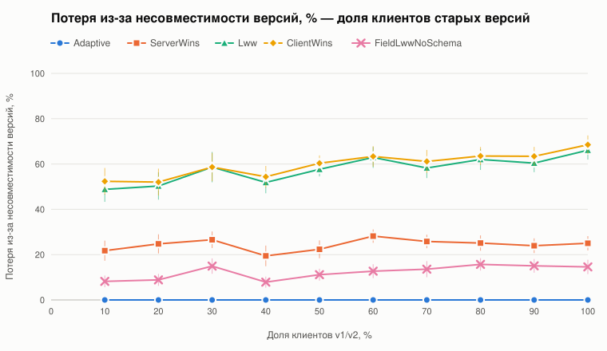
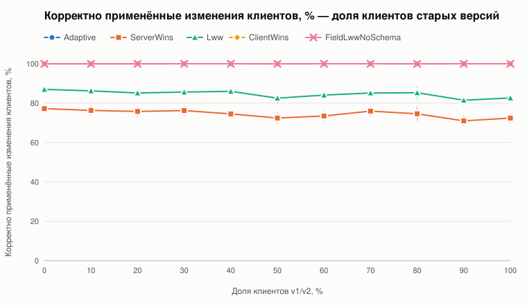
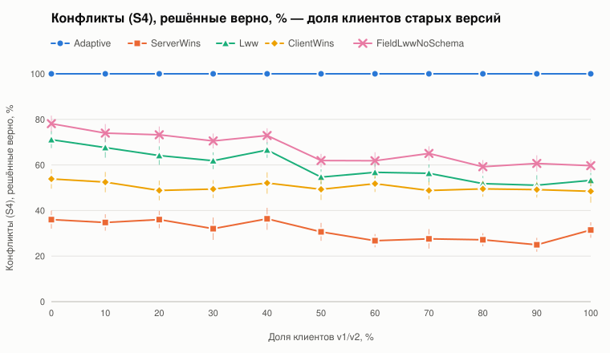
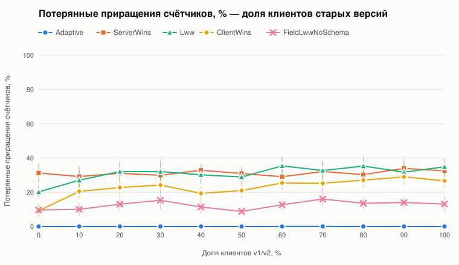
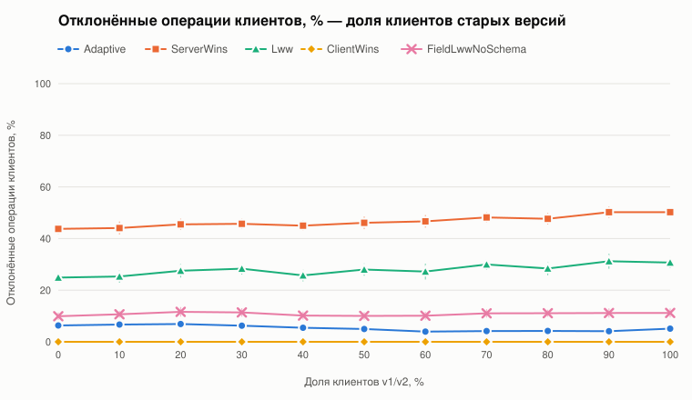

## Длина офлайна

**Потеря из-за несовместимости версий, %**

| Операций за сеанс офлайн | Adaptive | ServerWins | Lww | ClientWins | FieldLwwNoSchema |
| --- | --- | --- | --- | --- | --- |
| 1 | 0.0 ± 0.0 | 9.7 ± 3.6 | 65.5 ± 3.3 | 66.1 ± 5.0 | 4.0 ± 2.0 |
| 2 | 0.0 ± 0.0 | 15.1 ± 3.2 | 61.4 ± 5.5 | 63.7 ± 5.4 | 7.3 ± 2.7 |
| 3 | 0.0 ± 0.0 | 20.2 ± 3.2 | 57.0 ± 5.0 | 61.1 ± 5.0 | 11.1 ± 2.8 |
| 4 | 0.0 ± 0.0 | 29.4 ± 2.6 | 62.5 ± 3.7 | 63.6 ± 3.9 | 13.1 ± 2.8 |
| 5 | 0.0 ± 0.0 | 34.2 ± 2.7 | 60.8 ± 4.1 | 61.0 ± 3.5 | 20.6 ± 3.4 |
| 6 | 0.0 ± 0.0 | 33.2 ± 4.0 | 57.5 ± 4.9 | 59.7 ± 5.0 | 18.8 ± 3.0 |
| 7 | 0.0 ± 0.0 | 33.8 ± 3.1 | 63.6 ± 4.3 | 62.5 ± 4.9 | 22.2 ± 3.2 |
| 8 | 0.0 ± 0.0 | 38.2 ± 3.5 | 63.7 ± 3.5 | 62.6 ± 3.4 | 24.9 ± 3.0 |
| 9 | 0.0 ± 0.0 | 38.8 ± 3.2 | 64.6 ± 4.4 | 63.1 ± 4.5 | 25.9 ± 2.9 |
| 10 | 0.0 ± 0.0 | 39.5 ± 3.4 | 65.2 ± 4.3 | 61.8 ± 4.2 | 25.2 ± 2.5 |

**Корректно применённые изменения клиентов, %**

| Операций за сеанс офлайн | Adaptive | ServerWins | Lww | ClientWins | FieldLwwNoSchema |
| --- | --- | --- | --- | --- | --- |
| 1 | 100.0 ± 0.0 | 88.0 ± 2.4 | 92.4 ± 2.3 | 100.0 ± 0.0 | 100.0 ± 0.0 |
| 2 | 100.0 ± 0.0 | 79.0 ± 2.3 | 88.4 ± 2.2 | 100.0 ± 0.0 | 100.0 ± 0.0 |
| 3 | 100.0 ± 0.0 | 75.5 ± 2.4 | 85.2 ± 2.3 | 100.0 ± 0.0 | 100.0 ± 0.1 |
| 4 | 100.0 ± 0.0 | 71.7 ± 2.7 | 82.0 ± 2.5 | 100.0 ± 0.0 | 99.9 ± 0.2 |
| 5 | 100.0 ± 0.0 | 73.2 ± 2.7 | 83.8 ± 2.4 | 100.0 ± 0.0 | 100.0 ± 0.1 |
| 6 | 100.0 ± 0.0 | 73.1 ± 2.7 | 83.1 ± 2.4 | 100.0 ± 0.0 | 99.9 ± 0.1 |
| 7 | 100.0 ± 0.0 | 73.7 ± 2.2 | 83.5 ± 2.0 | 100.0 ± 0.0 | 100.0 ± 0.1 |
| 8 | 100.0 ± 0.0 | 71.5 ± 3.1 | 81.9 ± 2.6 | 100.0 ± 0.0 | 99.9 ± 0.1 |
| 9 | 100.0 ± 0.0 | 70.8 ± 2.4 | 82.0 ± 1.8 | 100.0 ± 0.0 | 99.9 ± 0.1 |
| 10 | 100.0 ± 0.0 | 73.2 ± 2.3 | 83.8 ± 2.0 | 100.0 ± 0.0 | 99.9 ± 0.1 |

**Конфликты (S4), решённые верно, %**

| Операций за сеанс офлайн | Adaptive | ServerWins | Lww | ClientWins | FieldLwwNoSchema |
| --- | --- | --- | --- | --- | --- |
| 1 | 100.0 ± 0.0 | 30.6 ± 11.8 | 63.8 ± 13.7 | 62.6 ± 11.5 | 70.5 ± 13.1 |
| 2 | 100.0 ± 0.0 | 34.4 ± 5.3 | 61.9 ± 5.3 | 52.9 ± 5.5 | 68.6 ± 4.6 |
| 3 | 100.0 ± 0.0 | 34.4 ± 4.0 | 62.0 ± 3.9 | 51.1 ± 4.4 | 68.8 ± 4.1 |
| 4 | 100.0 ± 0.0 | 28.9 ± 2.7 | 57.4 ± 3.4 | 47.7 ± 2.8 | 64.0 ± 2.8 |
| 5 | 100.0 ± 0.0 | 31.3 ± 2.8 | 56.8 ± 2.7 | 44.8 ± 3.7 | 66.4 ± 2.8 |
| 6 | 100.0 ± 0.0 | 31.7 ± 2.4 | 54.9 ± 3.3 | 44.7 ± 2.6 | 64.8 ± 2.8 |
| 7 | 100.0 ± 0.0 | 29.9 ± 2.2 | 57.8 ± 3.4 | 45.0 ± 1.9 | 66.7 ± 2.9 |
| 8 | 100.0 ± 0.0 | 30.0 ± 2.8 | 55.1 ± 2.8 | 41.9 ± 2.8 | 65.2 ± 2.3 |
| 9 | 100.0 ± 0.0 | 29.8 ± 2.7 | 56.1 ± 3.8 | 41.5 ± 2.7 | 66.1 ± 3.0 |
| 10 | 100.0 ± 0.0 | 29.0 ± 1.6 | 57.0 ± 2.5 | 41.2 ± 2.1 | 67.4 ± 2.0 |

**Потерянные приращения счётчиков, %**

| Операций за сеанс офлайн | Adaptive | ServerWins | Lww | ClientWins | FieldLwwNoSchema |
| --- | --- | --- | --- | --- | --- |
| 1 | 0.0 ± 0.0 | 14.1 ± 5.4 | 35.4 ± 7.8 | 29.3 ± 8.0 | 1.8 ± 1.7 |
| 2 | 0.0 ± 0.0 | 24.2 ± 5.2 | 33.8 ± 6.4 | 28.2 ± 5.4 | 6.3 ± 1.9 |
| 3 | 0.0 ± 0.0 | 29.7 ± 4.4 | 33.6 ± 4.7 | 28.0 ± 4.8 | 12.0 ± 3.2 |
| 4 | 0.0 ± 0.0 | 35.3 ± 5.6 | 36.8 ± 6.1 | 28.3 ± 3.9 | 17.1 ± 5.0 |
| 5 | 0.0 ± 0.0 | 40.6 ± 5.3 | 36.2 ± 5.1 | 24.1 ± 4.4 | 23.3 ± 5.2 |
| 6 | 0.0 ± 0.0 | 39.8 ± 5.6 | 35.6 ± 4.7 | 26.6 ± 3.3 | 21.6 ± 4.2 |
| 7 | 0.0 ± 0.0 | 45.3 ± 6.2 | 42.3 ± 4.9 | 22.3 ± 3.3 | 27.3 ± 4.4 |
| 8 | 0.0 ± 0.0 | 44.6 ± 5.4 | 37.1 ± 5.4 | 23.1 ± 2.6 | 23.4 ± 4.8 |
| 9 | 0.0 ± 0.0 | 47.0 ± 5.5 | 40.2 ± 4.7 | 26.1 ± 3.0 | 27.7 ± 4.1 |
| 10 | 0.0 ± 0.0 | 49.8 ± 8.4 | 41.7 ± 8.1 | 22.7 ± 3.3 | 32.0 ± 6.0 |

**Отклонённые операции клиентов, %**

| Операций за сеанс офлайн | Adaptive | ServerWins | Lww | ClientWins | FieldLwwNoSchema |
| --- | --- | --- | --- | --- | --- |
| 1 | 1.5 ± 0.9 | 21.1 ± 2.8 | 11.3 ± 2.5 | 0.0 ± 0.0 | 3.3 ± 0.9 |
| 2 | 3.6 ± 1.1 | 36.1 ± 2.3 | 20.5 ± 2.8 | 0.0 ± 0.0 | 7.6 ± 1.7 |
| 3 | 5.6 ± 1.3 | 43.7 ± 2.7 | 27.1 ± 2.8 | 0.0 ± 0.0 | 10.3 ± 1.7 |
| 4 | 6.5 ± 1.0 | 52.8 ± 1.8 | 33.6 ± 2.6 | 0.0 ± 0.0 | 14.3 ± 1.4 |
| 5 | 7.9 ± 1.5 | 56.5 ± 2.0 | 36.1 ± 2.5 | 0.0 ± 0.0 | 15.2 ± 1.5 |
| 6 | 8.6 ± 1.1 | 57.8 ± 2.0 | 39.5 ± 2.7 | 0.0 ± 0.0 | 17.2 ± 1.6 |
| 7 | 8.6 ± 1.0 | 62.2 ± 1.6 | 43.6 ± 2.7 | 0.0 ± 0.0 | 19.9 ± 1.5 |
| 8 | 11.3 ± 1.7 | 64.0 ± 1.7 | 45.5 ± 2.5 | 0.0 ± 0.0 | 22.7 ± 1.9 |
| 9 | 11.1 ± 1.2 | 66.6 ± 1.9 | 46.9 ± 2.7 | 0.0 ± 0.0 | 23.4 ± 2.0 |
| 10 | 11.5 ± 1.2 | 68.0 ± 1.9 | 49.5 ± 2.9 | 0.0 ± 0.0 | 25.6 ± 1.9 |

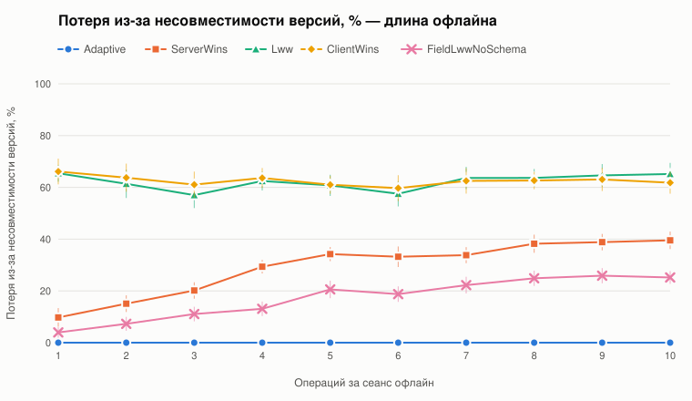
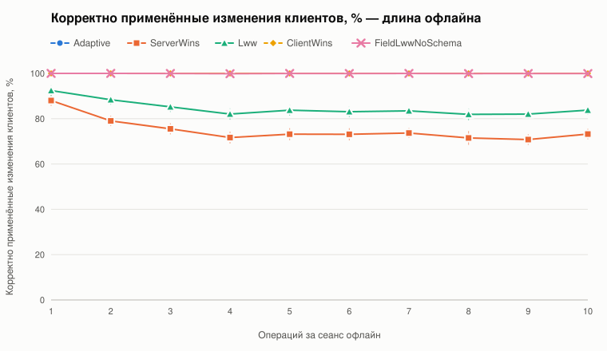
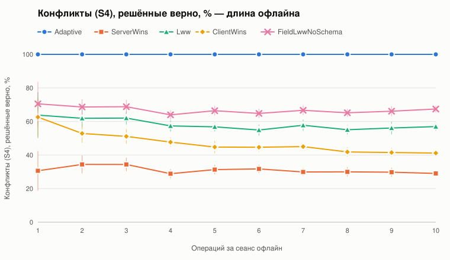
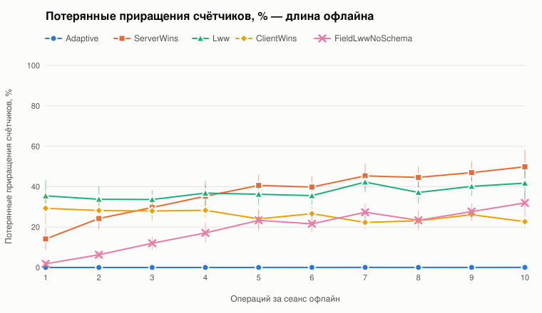
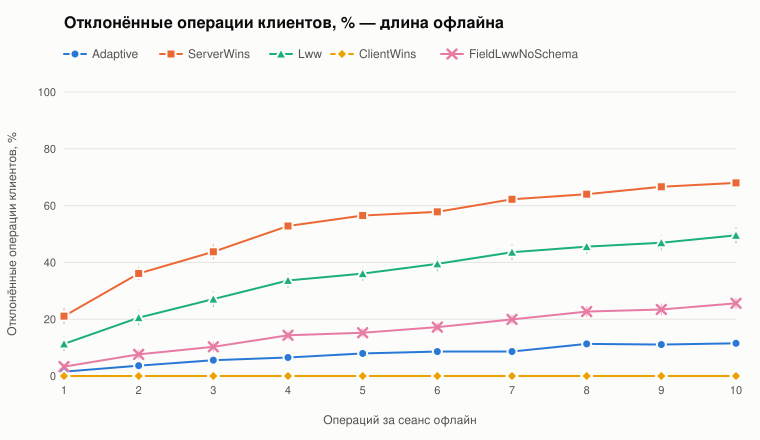

## Конфликтность

**Потеря из-за несовместимости версий, %**

| Доля операций над «горячей» записью, % | Adaptive | ServerWins | Lww | ClientWins | FieldLwwNoSchema |
| --- | --- | --- | --- | --- | --- |
| 0 | 0.0 ± 0.0 | 28.6 ± 3.9 | 63.2 ± 5.1 | 64.1 ± 5.1 | 18.9 ± 4.1 |
| 10 | 0.0 ± 0.0 | 28.7 ± 3.3 | 60.2 ± 3.9 | 62.7 ± 4.1 | 14.7 ± 3.3 |
| 20 | 0.0 ± 0.0 | 23.5 ± 3.3 | 55.0 ± 4.9 | 59.5 ± 4.6 | 12.6 ± 3.3 |
| 30 | 0.0 ± 0.0 | 25.1 ± 4.2 | 56.1 ± 3.3 | 57.7 ± 3.9 | 13.6 ± 3.0 |
| 40 | 0.0 ± 0.0 | 22.4 ± 3.3 | 59.8 ± 5.3 | 61.8 ± 5.2 | 11.8 ± 3.0 |
| 50 | 0.0 ± 0.0 | 19.1 ± 3.3 | 63.2 ± 4.9 | 65.3 ± 4.6 | 7.3 ± 2.9 |
| 60 | 0.0 ± 0.0 | 17.2 ± 3.4 | 62.1 ± 5.1 | 66.7 ± 5.6 | 7.4 ± 3.2 |

**Корректно применённые изменения клиентов, %**

| Доля операций над «горячей» записью, % | Adaptive | ServerWins | Lww | ClientWins | FieldLwwNoSchema |
| --- | --- | --- | --- | --- | --- |
| 0 | 100.0 ± 0.0 | 76.6 ± 1.7 | 86.1 ± 1.6 | 100.0 ± 0.0 | 100.0 ± 0.0 |
| 10 | 100.0 ± 0.0 | 74.2 ± 2.0 | 84.7 ± 1.7 | 100.0 ± 0.0 | 100.0 ± 0.0 |
| 20 | 100.0 ± 0.0 | 74.5 ± 2.0 | 84.9 ± 1.8 | 100.0 ± 0.0 | 100.0 ± 0.0 |
| 30 | 100.0 ± 0.0 | 76.7 ± 2.1 | 85.7 ± 1.6 | 100.0 ± 0.0 | 100.0 ± 0.0 |
| 40 | 100.0 ± 0.0 | 76.8 ± 1.9 | 85.6 ± 2.2 | 100.0 ± 0.0 | 100.0 ± 0.1 |
| 50 | 100.0 ± 0.0 | 78.5 ± 2.4 | 85.8 ± 1.7 | 100.0 ± 0.0 | 99.9 ± 0.2 |
| 60 | 100.0 ± 0.0 | 78.4 ± 1.7 | 86.2 ± 1.7 | 100.0 ± 0.0 | 99.8 ± 0.2 |

**Конфликты (S4), решённые верно, %**

| Доля операций над «горячей» записью, % | Adaptive | ServerWins | Lww | ClientWins | FieldLwwNoSchema |
| --- | --- | --- | --- | --- | --- |
| 0 | 100.0 ± 0.0 | 34.9 ± 3.6 | 57.2 ± 4.9 | 40.9 ± 5.4 | 65.9 ± 4.9 |
| 10 | 100.0 ± 0.0 | 31.0 ± 3.3 | 56.6 ± 4.7 | 45.0 ± 4.5 | 64.4 ± 4.5 |
| 20 | 100.0 ± 0.0 | 32.6 ± 4.6 | 60.0 ± 4.4 | 48.0 ± 4.2 | 64.9 ± 4.4 |
| 30 | 100.0 ± 0.0 | 34.8 ± 3.8 | 58.7 ± 4.3 | 48.9 ± 3.5 | 66.1 ± 3.3 |
| 40 | 100.0 ± 0.0 | 33.8 ± 3.0 | 61.0 ± 3.5 | 53.0 ± 3.5 | 66.3 ± 3.1 |
| 50 | 100.0 ± 0.0 | 31.1 ± 2.4 | 59.2 ± 2.9 | 52.6 ± 3.0 | 65.0 ± 2.2 |
| 60 | 100.0 ± 0.0 | 29.4 ± 3.3 | 58.8 ± 3.4 | 54.3 ± 3.3 | 63.7 ± 3.4 |

**Потерянные приращения счётчиков, %**

| Доля операций над «горячей» записью, % | Adaptive | ServerWins | Lww | ClientWins | FieldLwwNoSchema |
| --- | --- | --- | --- | --- | --- |
| 0 | 0.0 ± 0.0 | 30.4 ± 5.6 | 39.4 ± 6.0 | 30.7 ± 4.1 | 20.9 ± 6.2 |
| 10 | 0.0 ± 0.0 | 29.6 ± 4.3 | 32.6 ± 5.0 | 26.5 ± 4.9 | 12.8 ± 3.9 |
| 20 | 0.0 ± 0.0 | 29.7 ± 4.6 | 31.7 ± 6.6 | 24.7 ± 5.1 | 12.5 ± 4.3 |
| 30 | 0.0 ± 0.0 | 32.6 ± 5.7 | 29.5 ± 4.5 | 25.3 ± 4.3 | 13.1 ± 3.2 |
| 40 | 0.0 ± 0.0 | 26.9 ± 5.0 | 33.9 ± 6.7 | 28.5 ± 5.8 | 11.4 ± 3.3 |
| 50 | 0.0 ± 0.0 | 26.7 ± 4.8 | 36.5 ± 5.0 | 27.2 ± 4.6 | 13.5 ± 4.9 |
| 60 | 0.0 ± 0.0 | 28.7 ± 5.0 | 33.3 ± 5.2 | 29.4 ± 5.1 | 10.0 ± 2.9 |

**Отклонённые операции клиентов, %**

| Доля операций над «горячей» записью, % | Adaptive | ServerWins | Lww | ClientWins | FieldLwwNoSchema |
| --- | --- | --- | --- | --- | --- |
| 0 | 4.2 ± 0.9 | 42.8 ± 2.2 | 26.5 ± 2.3 | 0.0 ± 0.0 | 8.2 ± 1.3 |
| 10 | 4.2 ± 1.0 | 44.0 ± 1.9 | 25.9 ± 2.5 | 0.0 ± 0.0 | 7.4 ± 1.3 |
| 20 | 5.0 ± 1.3 | 44.0 ± 1.9 | 26.4 ± 2.9 | 0.0 ± 0.0 | 8.9 ± 1.7 |
| 30 | 4.4 ± 1.2 | 46.1 ± 2.7 | 28.0 ± 2.6 | 0.0 ± 0.0 | 11.0 ± 2.0 |
| 40 | 5.5 ± 1.1 | 45.9 ± 1.8 | 28.3 ± 2.6 | 0.0 ± 0.0 | 12.3 ± 1.7 |
| 50 | 6.6 ± 0.9 | 50.4 ± 2.1 | 31.0 ± 2.2 | 0.0 ± 0.0 | 15.3 ± 1.6 |
| 60 | 7.0 ± 1.1 | 53.7 ± 1.6 | 33.7 ± 2.9 | 0.0 ± 0.0 | 19.1 ± 2.0 |

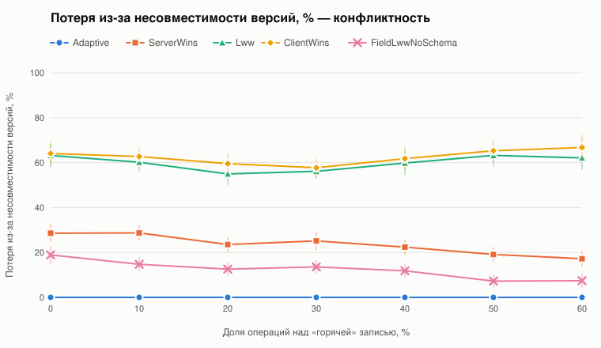
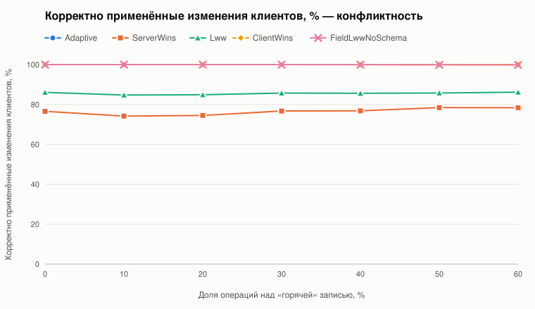
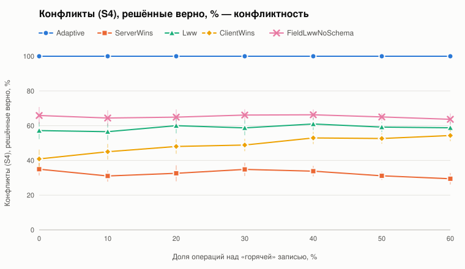
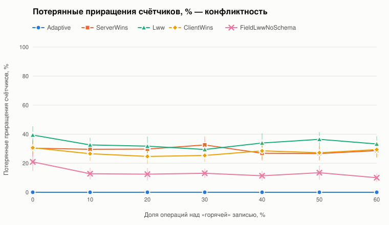
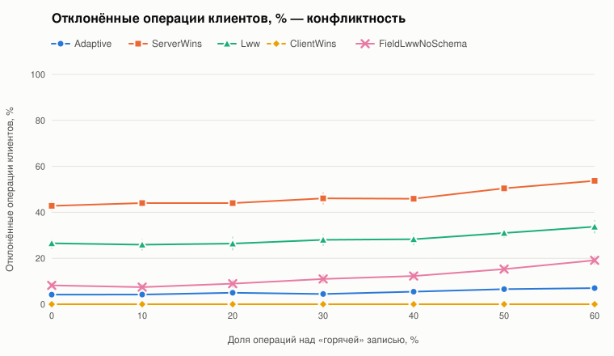

## Число клиентов

**Потеря из-за несовместимости версий, %**

| Клиентов | Adaptive | ServerWins | Lww | ClientWins | FieldLwwNoSchema |
| --- | --- | --- | --- | --- | --- |
| 2 | 0.0 ± 0.0 | 7.0 ± 3.0 | 53.8 ± 7.2 | 59.9 ± 5.6 | 3.3 ± 1.9 |
| 4 | 0.0 ± 0.0 | 19.0 ± 3.9 | 57.7 ± 5.5 | 59.9 ± 6.5 | 8.0 ± 2.3 |
| 6 | 0.0 ± 0.0 | 24.6 ± 3.2 | 59.8 ± 4.7 | 62.0 ± 5.2 | 12.4 ± 2.6 |
| 8 | 0.0 ± 0.0 | 31.2 ± 2.9 | 60.3 ± 4.9 | 60.9 ± 5.4 | 17.3 ± 3.6 |
| 12 | 0.0 ± 0.0 | 34.5 ± 2.9 | 64.4 ± 4.5 | 61.4 ± 4.8 | 24.0 ± 3.1 |
| 16 | 0.0 ± 0.0 | 38.7 ± 3.4 | 66.9 ± 3.8 | 62.2 ± 4.6 | 30.0 ± 3.4 |
| 20 | 0.0 ± 0.0 | 43.6 ± 2.7 | 66.4 ± 3.6 | 64.3 ± 3.6 | 28.3 ± 2.2 |

**Корректно применённые изменения клиентов, %**

| Клиентов | Adaptive | ServerWins | Lww | ClientWins | FieldLwwNoSchema |
| --- | --- | --- | --- | --- | --- |
| 2 | 100.0 ± 0.0 | 86.2 ± 2.6 | 90.5 ± 2.6 | 100.0 ± 0.0 | 100.0 ± 0.0 |
| 4 | 100.0 ± 0.0 | 79.3 ± 2.2 | 88.8 ± 1.9 | 100.0 ± 0.0 | 99.9 ± 0.1 |
| 6 | 100.0 ± 0.0 | 72.9 ± 2.8 | 84.0 ± 2.2 | 100.0 ± 0.0 | 99.9 ± 0.1 |
| 8 | 100.0 ± 0.0 | 73.6 ± 2.6 | 84.7 ± 2.0 | 100.0 ± 0.0 | 100.0 ± 0.0 |
| 12 | 100.0 ± 0.0 | 71.6 ± 2.5 | 82.9 ± 2.3 | 100.0 ± 0.0 | 100.0 ± 0.1 |
| 16 | 100.0 ± 0.0 | 74.2 ± 2.5 | 85.3 ± 2.1 | 100.0 ± 0.0 | 100.0 ± 0.0 |
| 20 | 100.0 ± 0.0 | 73.6 ± 2.2 | 84.4 ± 1.7 | 100.0 ± 0.0 | 99.9 ± 0.1 |

**Конфликты (S4), решённые верно, %**

| Клиентов | Adaptive | ServerWins | Lww | ClientWins | FieldLwwNoSchema |
| --- | --- | --- | --- | --- | --- |
| 2 | 100.0 ± 0.0 | 54.5 ± 12.6 | 70.0 ± 10.0 | 35.8 ± 11.2 | 72.0 ± 10.1 |
| 4 | 100.0 ± 0.0 | 35.6 ± 5.2 | 61.6 ± 6.2 | 55.3 ± 5.3 | 66.6 ± 5.8 |
| 6 | 100.0 ± 0.0 | 37.2 ± 5.7 | 59.6 ± 4.6 | 46.7 ± 4.9 | 66.8 ± 4.1 |
| 8 | 100.0 ± 0.0 | 30.0 ± 3.2 | 57.6 ± 3.5 | 46.5 ± 3.4 | 64.4 ± 3.1 |
| 12 | 100.0 ± 0.0 | 27.8 ± 2.2 | 58.1 ± 3.3 | 47.6 ± 3.0 | 65.9 ± 2.7 |
| 16 | 100.0 ± 0.0 | 26.4 ± 2.5 | 58.6 ± 2.9 | 41.8 ± 2.6 | 66.6 ± 2.6 |
| 20 | 100.0 ± 0.0 | 24.1 ± 1.7 | 56.7 ± 2.8 | 40.2 ± 2.5 | 63.6 ± 2.1 |

**Потерянные приращения счётчиков, %**

| Клиентов | Adaptive | ServerWins | Lww | ClientWins | FieldLwwNoSchema |
| --- | --- | --- | --- | --- | --- |
| 2 | 0.0 ± 0.1 | 11.0 ± 4.4 | 30.9 ± 8.2 | 29.8 ± 7.4 | 2.2 ± 1.8 |
| 4 | 0.0 ± 0.0 | 23.1 ± 5.2 | 30.1 ± 5.8 | 24.0 ± 5.3 | 7.6 ± 4.1 |
| 6 | 0.0 ± 0.0 | 28.2 ± 3.5 | 36.6 ± 5.6 | 27.5 ± 5.7 | 11.9 ± 2.8 |
| 8 | 0.0 ± 0.0 | 31.8 ± 4.5 | 33.4 ± 5.8 | 26.8 ± 3.5 | 17.9 ± 3.3 |
| 12 | 0.0 ± 0.0 | 37.6 ± 4.7 | 34.8 ± 4.6 | 23.6 ± 3.4 | 24.9 ± 5.1 |
| 16 | 0.0 ± 0.0 | 43.7 ± 5.9 | 41.4 ± 6.4 | 26.1 ± 3.2 | 34.0 ± 7.0 |
| 20 | 0.0 ± 0.0 | 43.8 ± 7.2 | 38.1 ± 4.3 | 25.8 ± 3.1 | 31.3 ± 4.9 |

**Отклонённые операции клиентов, %**

| Клиентов | Adaptive | ServerWins | Lww | ClientWins | FieldLwwNoSchema |
| --- | --- | --- | --- | --- | --- |
| 2 | 1.4 ± 0.8 | 21.6 ± 2.5 | 13.1 ± 2.9 | 0.0 ± 0.0 | 2.4 ± 1.1 |
| 4 | 3.6 ± 1.1 | 35.9 ± 2.6 | 20.3 ± 2.9 | 0.0 ± 0.0 | 7.3 ± 1.7 |
| 6 | 5.3 ± 1.4 | 46.8 ± 2.0 | 28.7 ± 2.5 | 0.0 ± 0.0 | 11.3 ± 1.5 |
| 8 | 6.6 ± 1.2 | 51.8 ± 2.1 | 32.1 ± 2.4 | 0.0 ± 0.0 | 14.8 ± 1.4 |
| 12 | 7.6 ± 1.0 | 59.3 ± 1.9 | 38.8 ± 2.6 | 0.0 ± 0.0 | 17.6 ± 1.6 |
| 16 | 10.8 ± 1.1 | 65.8 ± 1.6 | 44.9 ± 1.8 | 0.0 ± 0.0 | 23.8 ± 1.3 |
| 20 | 12.0 ± 1.0 | 68.2 ± 1.7 | 48.7 ± 2.1 | 0.0 ± 0.0 | 28.0 ± 1.8 |

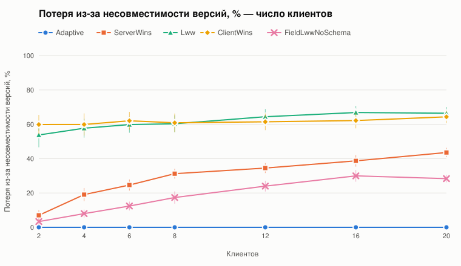
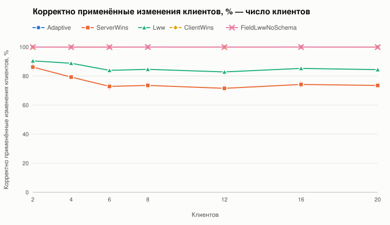
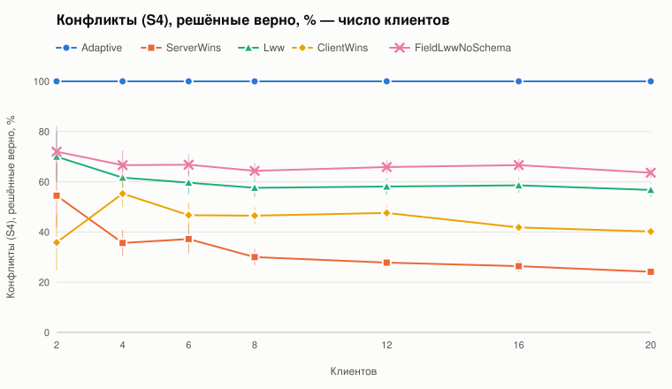
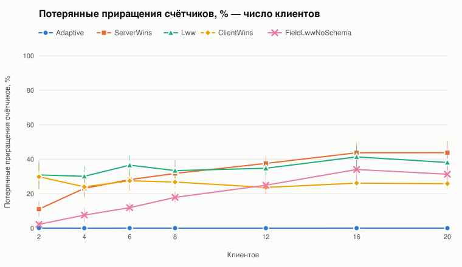
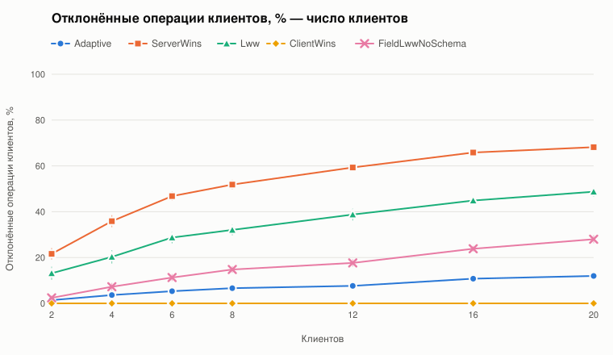

## Число записей

**Потеря из-за несовместимости версий, %**

| Профилей (по 2 предмета на профиль) | Adaptive | ServerWins | Lww | ClientWins | FieldLwwNoSchema |
| --- | --- | --- | --- | --- | --- |
| 2 | 0.0 ± 0.0 | 38.3 ± 4.4 | 63.1 ± 5.6 | 65.1 ± 6.0 | 23.7 ± 4.0 |
| 5 | 0.0 ± 0.0 | 18.2 ± 2.9 | 58.8 ± 4.9 | 60.0 ± 4.8 | 7.3 ± 2.4 |
| 10 | 0.0 ± 0.0 | 10.8 ± 2.1 | 61.3 ± 3.0 | 64.7 ± 2.5 | 6.0 ± 1.6 |
| 20 | 0.0 ± 0.0 | 7.3 ± 1.7 | 66.4 ± 4.0 | 68.3 ± 4.0 | 5.4 ± 1.3 |
| 35 | 0.0 ± 0.0 | 5.9 ± 1.2 | 66.6 ± 2.7 | 69.0 ± 2.5 | 4.3 ± 1.1 |
| 50 | 0.0 ± 0.0 | 5.1 ± 1.3 | 70.9 ± 2.9 | 71.5 ± 2.8 | 4.1 ± 1.2 |

**Корректно применённые изменения клиентов, %**

| Профилей (по 2 предмета на профиль) | Adaptive | ServerWins | Lww | ClientWins | FieldLwwNoSchema |
| --- | --- | --- | --- | --- | --- |
| 2 | 100.0 ± 0.0 | 68.6 ± 3.4 | 77.4 ± 3.4 | 100.0 ± 0.0 | 100.0 ± 0.0 |
| 5 | 100.0 ± 0.0 | 78.2 ± 1.7 | 87.7 ± 1.9 | 100.0 ± 0.0 | 100.0 ± 0.0 |
| 10 | 100.0 ± 0.0 | 87.0 ± 1.4 | 92.3 ± 1.1 | 100.0 ± 0.0 | 100.0 ± 0.0 |
| 20 | 100.0 ± 0.0 | 93.0 ± 1.1 | 96.5 ± 1.0 | 100.0 ± 0.0 | 100.0 ± 0.0 |
| 35 | 100.0 ± 0.0 | 93.5 ± 1.2 | 96.9 ± 0.9 | 100.0 ± 0.0 | 100.0 ± 0.0 |
| 50 | 100.0 ± 0.0 | 95.4 ± 0.9 | 97.8 ± 0.6 | 100.0 ± 0.0 | 100.0 ± 0.0 |

**Конфликты (S4), решённые верно, %**

| Профилей (по 2 предмета на профиль) | Adaptive | ServerWins | Lww | ClientWins | FieldLwwNoSchema |
| --- | --- | --- | --- | --- | --- |
| 2 | 100.0 ± 0.0 | 33.5 ± 3.8 | 56.1 ± 4.8 | 46.1 ± 3.7 | 66.8 ± 4.4 |
| 5 | 100.0 ± 0.0 | 31.8 ± 4.8 | 64.8 ± 4.8 | 52.4 ± 3.5 | 70.0 ± 4.1 |
| 10 | 100.0 ± 0.0 | 31.4 ± 4.2 | 63.8 ± 4.4 | 55.5 ± 4.0 | 65.7 ± 4.5 |
| 20 | 100.0 ± 0.0 | 30.5 ± 2.5 | 69.3 ± 4.7 | 59.1 ± 4.4 | 69.8 ± 4.5 |
| 35 | 100.0 ± 0.0 | 29.0 ± 3.7 | 69.9 ± 4.6 | 62.6 ± 6.8 | 71.1 ± 4.5 |
| 50 | 100.0 ± 0.0 | 33.0 ± 4.2 | 63.3 ± 3.7 | 59.7 ± 5.3 | 63.8 ± 3.7 |

**Потерянные приращения счётчиков, %**

| Профилей (по 2 предмета на профиль) | Adaptive | ServerWins | Lww | ClientWins | FieldLwwNoSchema |
| --- | --- | --- | --- | --- | --- |
| 2 | 0.0 ± 0.0 | 46.9 ± 11.5 | 39.0 ± 10.3 | 22.6 ± 5.2 | 26.2 ± 11.7 |
| 5 | 0.0 ± 0.0 | 25.3 ± 5.6 | 34.5 ± 5.8 | 26.5 ± 4.1 | 10.1 ± 3.0 |
| 10 | 0.0 ± 0.0 | 18.7 ± 4.1 | 35.1 ± 5.9 | 33.3 ± 5.5 | 6.5 ± 1.8 |
| 20 | 0.0 ± 0.0 | 14.2 ± 3.1 | 34.7 ± 5.6 | 31.4 ± 5.6 | 5.3 ± 2.0 |
| 35 | 0.0 ± 0.0 | 9.3 ± 2.6 | 35.1 ± 5.7 | 34.7 ± 5.6 | 3.1 ± 1.8 |
| 50 | 0.0 ± 0.0 | 6.2 ± 2.0 | 34.9 ± 5.9 | 34.8 ± 6.0 | 3.2 ± 1.7 |

**Отклонённые операции клиентов, %**

| Профилей (по 2 предмета на профиль) | Adaptive | ServerWins | Lww | ClientWins | FieldLwwNoSchema |
| --- | --- | --- | --- | --- | --- |
| 2 | 7.2 ± 1.7 | 58.4 ± 2.8 | 41.0 ± 3.4 | 0.0 ± 0.0 | 14.9 ± 1.9 |
| 5 | 4.8 ± 1.1 | 40.3 ± 2.2 | 22.6 ± 2.4 | 0.0 ± 0.0 | 9.1 ± 1.7 |
| 10 | 3.1 ± 0.7 | 28.0 ± 1.9 | 15.0 ± 1.7 | 0.0 ± 0.0 | 6.5 ± 0.9 |
| 20 | 2.2 ± 0.6 | 20.7 ± 1.8 | 9.6 ± 1.6 | 0.0 ± 0.0 | 5.7 ± 1.1 |
| 35 | 2.4 ± 0.7 | 19.2 ± 1.7 | 8.4 ± 1.2 | 0.0 ± 0.0 | 4.8 ± 1.2 |
| 50 | 2.1 ± 0.6 | 17.7 ± 1.8 | 9.0 ± 1.4 | 0.0 ± 0.0 | 6.1 ± 1.3 |

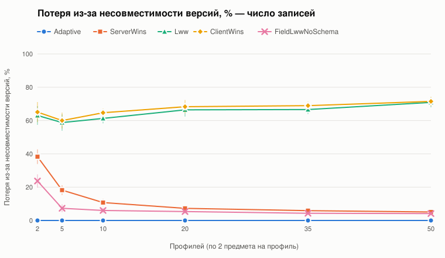
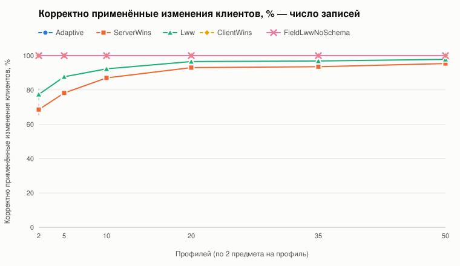
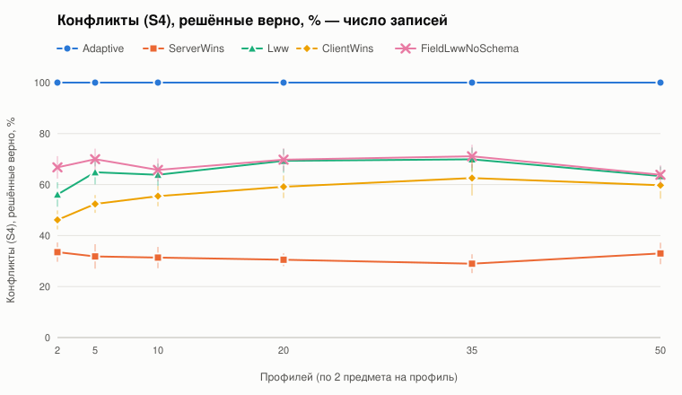
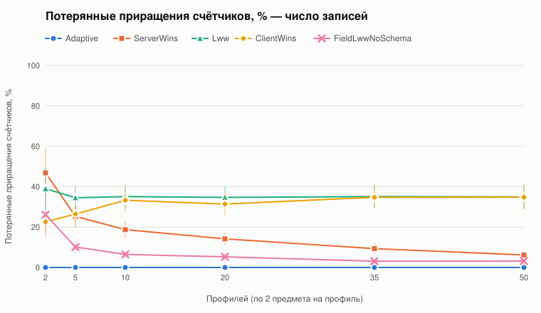
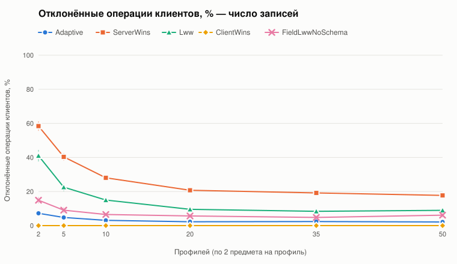

